# 业务督导中心数智管理平台

本项目是一套面向业务督导、站点整改和管理分析的综合平台。系统以巡检业务为主线，同时提供考核、站点主数据、数据备份、系统安全和 AI 分析等能力。

> 本文档以当前代码中的实际逻辑为准，重点说明巡检系统的功能和状态流转。

## 服务器部署

在服务器项目根目录执行 `bash deploy.sh`（也可执行 `./deploy.sh`），一次完成前端和后端更新，无需分别运行旧脚本。脚本只拉取一次代码（仅允许快进），加载服务器 `.env` 并检查生产配置，然后依次构建发布前端到 `/var/www/ywddzx`、移除不再需要的 Vite 开发容器、重建后端、等待迁移及 Gunicorn 启动、验证运行时数据库结构。兼容 `docker compose` 和旧版 `docker-compose`；前端使用 `npm ci --include=dev` 按锁文件安装构建依赖，后端版本从 `frontend/package.json` 读取并覆盖过时的环境值。

运行账号需要项目目录、Docker及 `/var/www/ywddzx` 的操作权限。服务器须配置 `APP_SECRET_KEY`、`DB_PASSWORD`、`WEBAUTHN_RP_ID`、`WEBAUTHN_ORIGIN` 和 `CORS_ALLOWED_ORIGINS`，且 Nginx 已加载 `deploy/nginx/ywddzx-cache.conf` 与 `ywddzx-security.conf`。配置或构建失败时不会替换前端文件；后续步骤失败会停止并说明阶段，不自动回滚已完成的部署。此脚本会实际更新生产服务并执行迁移，请仅在准备部署时运行。

已经应用到数据库的迁移版本不能随未提交的功能代码一起删除，否则后端会在迁移阶段退出并循环重启，前端可能只显示Passkey暂不可用。`20261024_001` 是已撤销HTML原型的兼容节点：不新建、删除或使用原型表，只保留可解析的版本链；已有该版本的本地备份可以正常升级，未运行过原型的数据库也不需要创建其表。不得通过删除Passkey或随意修改数据库版本号来绕过启动错误。

大模型 Key 必须进入后端容器，仅在 SSH 交互终端里 `export` 不代表 Docker 已收到。部署会保留当前部署环境及项目 `.env` 的四个厂家 Key，对缺失项依次读取专用配置文件 `AI_KEYS_ENV_FILE`（默认 `/etc/ywddzx/ai.env`）、`/etc/environment` 及部署账号的 Shell 配置（兼容旧 `.bashrc`、`.zshrc` 等）。只读取 `DEEPSEEK_API_KEY`、`ZHIPU_API_KEY`、`DASHSCOPE_API_KEY`、`MIMO_API_KEY` 的单行固定值赋值，不执行配置中的命令、变量展开或 Shell 启动逻辑；专用文件应由部署账号保管并设为 `0600`，不要提交 Git。未配置的厂家保持可选，不影响其他厂家。部署日志仅显示是否配置及配置来源，不显示值；密钥只在重建后端的 Compose 子进程中补入，不额外传给前端构建。部署结束还会从后端实际环境核对四个厂家状态，页面的“Key 已配置”仍不代表余额、模型授权或网络可用。

## v11.3 统一照片上传与完整画面

巡检登记（含亮点）和提交复核共同使用 `InspectionPhotoUpload.vue`，同一套文件选择、手机拍照、剪贴板粘贴、桌面拖入、最多三张自动拼接、单张移除、继续添加、图片编辑与放大预览功能。编辑支持裁剪缩放、位置调换、圆形/矩形标注及线宽调整。新增图片按顺序处理，关闭、清空及切换问题会取消旧的异步结果；处理和编辑时不能提交。

新拼接布局默认等比完整显示，不再用铺满裁切方式丢弃画面边缘，缩略图也完整显示；用户主动缩放裁剪仍生效。旧编辑布局未指定适配方式时保留原有裁剪语义。提交仍是一张压缩后的JPEG，后端接口与照片必填/选填规则不变。登记草稿保留最终照片，不保留拼接前各原图的编辑状态。

## v11.2 人员编组与执行保护

今日外勤组有站点派工但尚未开工时允许调入、调出组员。组员在派工之后，为分派站点、对应检查表创建巡检记录，或给复用的月度巡检记录新增问题，整组即锁定。核对创建时间及当前派工成员，不以“已有计划”、非本组人员的记录、非任务站点/检查表或派工前的记录锁组；此锁定实时生效，与17:00的档期实绩展示窗口分离。已派站的带队人须先撤下派工再改变带队关系，已有视频派工人员仍按个人锁定，其他内勤人员可调整。

采用成员调整时，沿用同一排班事务锁，同步季度现场和年度计量计划中的成员、个人任务及待选区。计划中仍保留原带队组、站点和日期；旧任务撤销并保留成员快照，新任务另存，不改写实际记录。保存以短事务的记录表共享锁防止巡检写入与实绩校验交叉，沿用3秒锁等待及10秒语句超时；版本、档期、准驾证或审计异常均回滚。

“当前生效的今日巡检安排”同时读取当日有空、账号匹配、没有站点派工且尚未在分组中的人员，显示为“有空待编组”。将没空改回有空后，无需重新随机分组，可拖动或点选加入已有外勤组或内勤视频组；管理人员仍不能加入另一管理人员带队的外勤组，可独立带队。预览与拖动不会自动保存，须采用方案才同步生效。下方v10.8、v10.6及更早章节的外勤“已派站即整组锁定”描述为历史规则，已由本节替代，排班表站点整行锁定规则不变。

## v11.1.1 站间路网数据库

现行智能排班只读取PostgreSQL中的完整路网批次，不会在浏览、预览或确认时请求高德。对所有有效坐标的站点建立 `n*(n-1)/2` 个站对；每对固定取ID较小站点到ID较大站点的一个采样方向，往返共用此估算，不假定双向路况差异。按用户选择采用高德批量驾车估算（`v3/distance type=1`，每批至多100起点），用于粗略安排，不等同于实时最优导航。仍先满足计量目标、再均衡片区，最后按数据库行车时间组合站点。

`driving_matrix_runs/pairs/state` 保存采集批次、进度及当前发布指针；新批次收齐后同事务整体发布，只保留最近两份完整站对明细，失败不覆盖旧批次，中断可按同一任务续采。`driving_matrix_previews` 保留30分钟、绑定操作人与日期的派工预览，确认时仍校验人员、实绩、目标和版本。已删除v11.1的按需联网与SQLite两小时路网缓存实现，旧缓存文件不再被使用；路网数据没有两小时失效或实时回源。

部署迁移 `20261025_002`，并由 `deploy/install_driving_timer.py` 安装独立的 `ywddzx-driving-refresh.service/.timer`，北京时间每周一09:30运行，`Persistent=true` 可补执行停机错过的周期。部署提交一次后台初始化/补漏请求，CLI通过PostgreSQL会话级锁与已完成周期判断防止重复采集，不在Gunicorn中启动采集线程，不要求用户保持网页打开。采集按批提交、限速、不持有业务事务或排班锁。采集遇到网络/额度问题时记录失败并保留已收集部分，后台间隔10分钟有限重试，1小时内最多启动3次；运维可用 `systemctl start ywddzx-driving-refresh.service` 续采，页面不提供修改或触发按钮。

排班系统的“路网数据”位于“排班地图”下方，仅GET读取；原网址 `/management/driving-matrix` 和显示开关键保留，独立 `view_driving_matrix` 权限默认仅root，可通过角色模板/个人权限分配。展示采集进度、有效站点、已发布站对、成功批次及下次更新时间；站间明细按页查询，支持任一端站名的部分名称搜索、可达情况及行车用时/行驶距离双向排序，未应用条件与当前结果分开呈现。不可达不代表0分钟。新站或坐标变更等待下次周更新，不在排班中补查；失败或中断时原有效批次仍可用。高德Web服务Key继续使用 `AMAP_WEB_SERVICE_KEY` / `AMAP_KEY`，不写入业务表或前端。

## v11.1 驾车时间优先智能排班（历史实现，已由v11.1.1替代）

现场智能排班继续先补当月计量年度目标、再均衡片区季度覆盖率，在这些约束下按高德预计驾车秒数组合站点，时间相同时再比较驾车米数，替代v10.1的直线距离聚类。采用容量约束的启发式组合与有限交换，不承诺全局最优；组内最多10站用有向道路矩阵求最短行车时间的开放路径，不增加办公室绕行目标。预览显示检查顺序、站间预计分钟、行驶公里及逐段行车信息，单站无站间行程，视频派工和已有实绩不改动。

后端使用高德 `https://restapi.amap.com/v3/distance` 的 `type=1` 驾车矩阵，一批最多100个起点；不是`type=0`直线测量。以选中站点为目的地按需批量查询候选起点，使用实际返回的秒数、米数，区分双向道路，不将未查询或不可达路线当作0。`.schedule-driving/routes.sqlite3` 位于共享storage内，文件0600；按坐标和方向缓存最长2小时，不长期伪装实时路况。相同候选/目标/人员容量复用已计算方案，单机多Gunicorn进程通过文件锁避免重复计算，间隔限流、65秒查询预算；首次数据量较大可再次计算继续使用已缓存结果。不新增后台任务、依赖或业务数据库迁移。

高德查询在业务连接关闭后执行，不持有全局排班锁。确认派工不访问高德，使用绑定操作人、日期、原预览token且有效30分钟的路线快照，并在原调度事务内重查坐标、人员档期、实绩、计量目标、准驾证、排班及配额版本。发生变化要求重新预览，失败全部回滚原排班；高德Key缺失、额度不足或路径异常时明确提示，不退回直线距离或伪造方案。缓存可清理重建，但请勿在正在计算/确认时操作其文件。

高德浏览器地图Key与Web服务Key平台类型不同，后端配置 `AMAP_WEB_SERVICE_KEY`（Web服务类型），兼容服务器现有的 `AMAP_KEY` 别名。可在项目 `.env` 或 `/etc/ywddzx/amap.env` 设置，后者建议0600；也支持 `AMAP_KEYS_ENV_FILE` 指定文件，并安全读取部署账号 `.bashrc` 等既有配置。部署只读取固定值，不执行Shell配置代码、不输出密钥，不注入前端；未配置不影响站点地图和手动排班，但多站现场智能组合会提示配置，不能用浏览器Key冒充。高德服务额度、IP白名单和计费以实际账号为准。

下文v10.x中本地直线聚类、不依赖在线地图的说明为历史实现，现行现场智能组合以本节v11.1为准；历史派工和巡检实绩不追溯重算。

## v11.0 全局显示开关与月度站点评分

桌面界面采用80%的紧凑显示密度：Vite沿用现有PostCSS流水线，对字号、间距、按钮、表格和响应式断点中的固定像素尺寸统一换算。不是对DOM使用zoom/transform，不修改浏览器缩放，地图、画布、拖拽坐标和视口高度保持原坐标体系。768px及以下移动端、打印和独立HTML报告保留原尺寸；导出HTML时识别并移除紧凑分支、还原文档响应式规则，PPT文件不受影响。公共比例与分支标识位于 `frontend/src/utils/uiDensity.js`，转换在 `frontend/build/desktopDensity.js`，不引入新的运行时依赖。

HTML阅读修复：财务分类共用带显式配色、实际占比和零值处理的统计组件，卡片不再强行拉齐高度。设备设施从成稿的 `equipment_analysis` 读取高频原因、特性和重点问题，按保存片区顺序展示全部受检站点，不再依赖新模板不生成的旧分析字段；保留旧成稿的兼容展示。非油增加概览指标、可展开的片区/类别明细及完整原文说明，统计、图片和原因均来自成稿，展开与导出不重新取实时配置或调用AI；HTML导出展开所有正文，PPT生成逻辑不变。

报告后台线程通过共享storage下的 `.report-job-locks` 文件占用锁标识存活（部署的单机多Gunicorn进程环境）。任务认领使用数据库条件更新，重复线程不能再次认领同一任务；读取生成状态或准备新任务时，仅将超过3分钟无更新、且没有存活占用者的任务记录为“已中断”。长时间AI请求仍持有锁，不按固定时长误判；状态修正保留原进度、最后成功成稿和AI缓存，不自动发起收费重试、不新增定时扫描。占用文件不能在任务运行中删除；该机制不替代跨主机队列或自动续跑。

报告生成的查看权限拆分为“督导中心视角”（兼容原 `view_inspection_reports`）和“处室部门视角”（`view_department_inspection_reports`）。督导中心保留完整工作台，生成仍需 `generate_inspection_reports`；处室视角默认HTML阅读，可切换PPT并导出，不展示共享配置、生成操作日志或生成操作。处室只按月份选择历史成稿，未生成或不可读取的月份置灰；按保存的 `report_month` 归档，同月多份成稿取最后成功生成且兼容当前报告的数据，不把跨月自定义日期范围自动拆成多个月。首次打开显示最后成功成稿所属月份，切换类型重新读取该类型的可用月份，不修改任何配置、不调用AI；不覆盖督导中心原有的PPT/HTML偏好。质安部对应质量计量与安全质量，发展计划部对应设备设施，油气事业部对应现场服务，非油事业部对应非油，财务部对应财务。两种视角同时授权时使用督导中心视角；处室权限对其他角色不生效，不改变巡检业务页的数据范围。

部署迁移 `20261025_001` 将五类处室现有角色及个人的旧查看授权/拒绝迁移为处室视角，并关闭其旧督导中心授权，保留个人拒绝、其他角色和片区/检查表绑定；迁移不会给原先无查看权限的账号新增授权。菜单、路由、成稿读取、PPT导出、任务状态、预览及下载均校验相同权限；配置与AI生成接口仅允许督导中心。HTML模式的“导出HTML”直接下载当前成稿的独立文件，内含样式与图片；PPT模式仍走原PPT导出。HTML导出不调用AI、不读取当前配置，图片请求复用且最多并发4个，读取失败明确报错，不输出缺图文件；不执行脚本或加载外部资源。

页面显示管理新增 `manage_page_visibility` 独立权限，默认仅root启用，允许分配给其他角色或账号。菜单、路由、管理API统一校验该权限，不再依赖用户管理权限。开关修改只提交变化项，立即保存至共享配置，失败还原；一键全部显示也直接保存。配置不改变业务数据权限，隐藏页对所有账号的菜单生效；有权限的用户始终可以进入显示管理恢复页面，管理入口不参与自身隐藏。在线且可见的窗口每30秒核对全局显示配置，重新聚焦立即核对；读取失败保留上次成功配置，旧请求不能覆盖刚保存的配置。修改人与开关变更写入安全审计，同事务失败回滚。

站点评分改用月份选择器，默认上海时间上一个自然月。评分读取、人工调整和导出统一使用 `YYYY-MM`；兼容旧客户端传入完整自然月的起止日期，不再接受逐日或跨月评分范围，人员出勤的日期范围不变。仅启用且存在 `is_scorable` 字段的检查表可用，扣分仍只使用审核通过的问题，同规范只扣一次。保持既有等权评分及人工调整记录。前端仅读取选中检查表的台账，切换条件取消旧请求；明细可按规范ID、内容、问题描述及扣分/调整状态筛选，导出与调整弹窗保存打开时的月份快照。

## v10.9 视频巡检整站异常免检

被分配月度视频任务的用户可从右上角“今日安排 → 我的巡检待办”按站点击“报告视频异常”，填写1至500字的必填原因。确认后，该站本月安全、计量、现场三张视频检查表统一异常免检，不再计入个人待完成或历史视频未完成。今日卡片保留异常状态和原因；历史任务退出待完成分类，原始任务和留痕不删除。仅适用于普通月度视频任务，不影响现场、年度计量及其他月份。

视频排班整站置灰，原因直接显示，详情可看登记人、时间及原派工。异常免检不算实际检查完成，不虚构巡检记录；已有部分实绩仍独立保留。异常站点整行锁定，不能改派、清空或被智能方案替换；人员档期的原派工追溯也展示异常原因，不凭免检生成实绩。

`POST /api/my-schedule-tasks/<task_id>/video-exception` 只认登录用户及服务器当前整站三表派工，不依赖排班管理权限，不接受指定他人的身份。仅可处理已到执行日期、仍分配本人且未全部完成的任务；过期预览、改派、取消、非视频任务被拒绝。沿用跨进程排班事务锁，同原因重试幂等，冲突不覆盖；事务失败全部回滚。迁移 `20261023_001` 新增 `inspection_schedule_video_exceptions`，保存原因、提交人/时间、站点与派工快照及任务ID；不删除业务数据，不增加后台扫描。

## v10.8 今日人员巡检方案与档期联动

人员档期“一键安排今日巡检”采用方案工作流：先确定有空管理人员的现场/视频分工，点击“智能生成今日巡检方案”生成草案；拖动或手机点选只调整草案，不立即写入。用户可放弃，或点击“采用方案并覆盖今日安排”统一保存。弹窗保存后保持打开，展示最新生效安排，可继续调整未派站人员或重新生成。重新生成保留已派站外勤组的完整成员和已派站视频人员，只对其他有空人员生成方案；保留原准驾证、工作日及17:00实绩保护。

大学生可在未派站组之间调整；管理人员只能独立带队或转内勤，不得加入另一位管理人员的外勤组。带队管理人员转入内勤时原外勤组解散，组内大学生全部转内勤；内勤管理人员可点击独立带队建立自己的组。最终采用时核对外勤组至少1名持准驾证人员。

未派站人员可直接将今日档期改为没空：大学生或内勤人员从当前安排移除；带队管理人员移除并将原组大学生转入内勤。已派站外勤组整体锁定，视频人员按人锁定，已有实绩的档期仍只读。档期、分组版本、今日调度待选卡与审计在同一排班事务锁内保存，退役旧组待选卡但不删除原历史，不修改已派站计划或实际巡检记录；异常全部回滚。

`GET /api/staff-availability/today-inspection` 增加当前方案的 `current_token`；`POST` 增加 `action=apply`，支持 `source=current|generated` 和仅含 `person_id/leader_id` 的调整序列。服务端根据当前身份与数据重建方案，不接受客户端提供的姓名、角色或任意人员快照；采用前重新检查版本、档期、派站锁定及实绩，防止并发或过期草案覆盖。沿用人员档期查看/编辑权限，保留旧接口调用兼容，不新增数据库迁移、后台任务或付费AI调用。

## v10.7 我的巡检待办进度与历史

右上角“今日安排”打开的个人待办按站点展示逐表状态、完成数/总数、进度条、原分组成员和完成记录。今日已完成项仍可查看；未完成现场及视频在上海日期跨日后分别进入“历史现场未完成”“历史视频未完成”。历史站点仍有未完成表时同时展示完成的同站表，避免进度分母丢失；整站完成后离开历史列表，任务与原派工快照仍保存。现场不再跨日自动归档销项。

完成按排班表相同的半开覆盖周期匹配 `inspections`：普通现场为季度，年度计量两列均为年度现场任务，普通视频为月份；同站同表任一记录即可，不看问题审核或是否本人录入。其他月份/季度/年度的记录不能销掉旧周期任务；最后一条有效记录删除后恢复未完成，停用/重复定义检查表不冒充完成。人员档期的派工执行追溯仍按原计划日起核对，不混用两个统计口径。

`GET /api/my-schedule-tasks` 保留原响应字段并增加 `buckets`、`total_groups` 和分页元数据，支持 `bucket=all|today_offline|today_online|history_offline|history_online`、`page`、`page_size`（默认24组、最大50组）。按完整站点组分页，不切断检查表；分类计数为当前用户全量统计，不受当页影响。身份只取登录会话，忽略客户端传入的其他用户ID，不依赖排班管理权限。状态缓存用原非阻塞排班锁延迟核对，锁忙时仍以只读记录投影展示准确进度；不新增后台扫描。旧 `expired` 现场任务仅在仍对应原排班且未被新派工替代时恢复，不复活取消/改派的旧任务。不新增表或数据库迁移，不改写实际巡检记录。

## v10.6.2 今日调度剩余站数

今日调度待选区按视频人员或完整外勤组去重，只展示姓名/组名和红色剩余站数角标，不展示历史来源站点。剩余站数以全局目标减去今日表内已派的不同站点数计算；同站多检查表只算1站，季度现场和年度计量共用外勤组计数，已开始的今日计划仍占名额，其他日期及未纳入名单的站点不计入。仅剩余大于0时显示待选卡片，名额已用完或已有超额计划时隐藏；原始记录不删除，撤下未开始计划或增加目标后自动恢复展示。待选区派站在原事务锁内按最新共享目标和排班重查，拒绝旧卡片、重复卡片或并发请求超额派站，拒绝发生在目标旧计划被移走前，不改动已有排班与实绩。前端读取、拖拽和点选落位均做相同容量防护。原始待选记录和调度审计仍保留；移除合并卡片会同步移除同组/人的隐藏重复待选记录。

智能排班打开先读取 `GET /api/inspection-schedule/quotas` 的共享站数（默认现场2站、视频3站）；调整后点击计算，以 `save_quotas` 和 `quota_revision` 同事务保存配置及审计，再生成预览，失败全部回滚。查看/编辑权限沿用巡检排班授权，不按用户分别存储。部署执行 `20261022_003`，仅新增配置与审计表，不清空既有计划、待办或历史数据。

## v10.6.1 智能排班依据展示

今日智能排班弹窗加宽至最多1280px，手机保持自适应。人员分工下连续展示“当月计量年度计划”和“现场片区覆盖均衡”，方案标题与人数/站点/检查项汇总放在具体方案上方。两条依据右侧按最终方案中 `metering_priority` 站点与普通现场站点的实际入选数量显示是否采用；只有计量优先入选时普通均衡不标为采用，混合方案分别显示站数。无目标、目标已完成、已有计划预留或没有可执行现场方案均显示明确状态；修改参数后提示重新计算，不将旧标识当成新方案。仅调整说明与布局，不改动选站算法、API或派工事务。

## v10.6 今日智能排班与派工后分组锁定

“今日一键排班”更名为“今日智能排班”。新界面使用 `/api/inspection-schedule/auto` 的 `strategy=replace_today` 策略，只依据人员档期已保存且有空、账号启用、资质符合的完整现场组/视频人员计算方案。今日手工计划不再排除候选人、不计入任务量或片区预留；过去未开始的计划可成为新派站候选，未来日期的计划仍受保护。现场继续优先补足本月计量目标、均衡片区实绩覆盖与紧凑分组，视频按实际季度工作量平衡，不调用AI或在线地图。已开始的今日站点消耗对应组/人的每日站数名额，避免额外超派。未保存人员分组时不凭空派人；原API未指定策略的增量预览/确认行为仍兼容保留。

计算方案仅预览，不改动排班表。界面明确列出替换范围，必须确认后以 `replace_confirmed=true` 应用；后端在全局事务锁内重新核验人员、档期、实绩、整板版本与方案指纹，再撤下今日未开始的旧安排并应用新方案，同步取消旧待办、创建新待办及记录前后审计。保留已开始整行、其他日期计划、巡检记录和历史事件，任何失败整体回滚，不分成两次HTTP写入。并发修改后旧方案拒绝覆盖，重新计算后再应用。

“今日已确认排班”独立为按钮窗口，通过 `GET /api/inspection-schedule/today` 只读查询，沿用巡检排班查看权限，不要求编辑权限，不新增独立权限。按现场外勤组和视频检查人分区展示实际保存的站点、人员及检查项进度；年度/季度同站同组的任务合并展示。窗口打开核对，展示中低频自动更新，关闭或隐藏停止轮询。不再把已确认安排混在智能方案内。

人员档期已保存分组的锁定以排班表中当天仍存在的计划为准，而非待办状态：外勤组只要有今日派站，不可调入或调出任何组员；视频人员有今日派站时仅锁定本人，未派站的同池人员仍可调整。现场、年度计量、视频三表统一核验；撤下对应组/人的全部今日计划后才解锁，只有待选卡片不会锁定。前后端共同保护，不能通过直接调用move或重新确认随机分组绕过。原有编辑权限、准驾证及实绩约束保留，派工后不再静默改写组员快照。

人员档期详情采用左右双栏，站点任务可折叠展开；手机上下排列，避免长条弹窗。操作警示在原生弹窗内部顶部显示短暂通知，可手动关闭，不再追加长段红字或要求反复关闭重选。排班工具按钮统一高度和字号，计量目标输入框聚焦清空显示、未输入离焦恢复原数值，取消数字加减小按钮；智能方案的计量进度仅显示本月有目标的片区。无新增迁移、依赖或后台任务。

## v10.5.1 派工进度与整站执行锁定

今日一键排班的计量片区圆环显示年度已查站点/纳入站点：年度表任一适用列出现绿色即计该站已查，重复记录、多列完成仍只计一站；监控运行站点的灰色视频格不计。月度目标、本月已查、计划预留与本次拟派另列，本月实绩也以任一适用计量表记录计站点，避免把年度累计混入当月目标。仅有效且定义唯一的检查表参与，与排班表保持一致。

弹窗单独展示“今日已确认排班”，从数据库保存的当日计划读取，不依赖当前能否继续自动派工。按现场组/视频人员合并列出站点、计划成员与各检查项进度，年度与季度同站任务合并，不覆盖原始派工快照。确认后弹窗不关闭，刷新已确认安排和新预览；重新打开仍能查看。其他日期的计划不冒充今日排班。

三表任一适用检查项有巡检记录，整行即只读；同组、同日、同站的季度与年度联动计划一并锁定。编辑、多选、拖入/拖出待选区、置换及一键清空均由前后端共同保护，清空只移走未开始站点，不动已开始整行。分组调整也不回写已开始站点的原组快照；独立且已开始的另一张表不会被联动补写剩余项。删除/移走实际记录后可按现存记录重新判断，不虚构永久完成。页面的三类站点概况仍沿用v10.5整站完成口径，与任一检查项完成后的执行锁定是不同概念。

未完成计划在上海日期超过计划日期后显示黄色及“逾期未检查”，当日/未来计划仍红色，已有实绩保持绿色。颜色由读取时的日期与记录计算，不清空原人员、日期、组、待办或审计；v10.7起现场与视频未完成待办跨日分别保留在对应历史分类。不新增数据库结构、后台扫描、付费AI或地图调用，继续沿用原权限、事务锁、版本校验和回滚。

## v10.5 年度计量排班与片区月度计划

巡检排班提供季度现场、年度计量现场、月度视频三个切换面板。三种排班共用155站的排序底表，实际是否纳入仅依据站点对应的现场/视频计划开关，不再额外使用硬编码的视频排除名单（例如泗砖）；排除未纳入站点后连续编号，保留相对顺序，序号不作为站点或排班的标识。年度计量使用现场纳入属性，列对应计量现场和计量视频检查表；计量视频仅对 `monitoring_status='未运行'` 的站点可用，不复用普通月度视频排班意图。已检查绿色并锁定，已排班红色，计划与实际人员独立保存；三个排班表采用加深加粗的网格，手机卡片使用相同颜色的分隔线，避免相邻同色单元格连成一片。页面仅显示当前筛选站数，不再展示固定名单和排除名单提示，不自动修改基础档案中的纳入开关。

“计量年度计划”按年保存12个月各片区的站点目标，沿用巡检排班查看/编辑权限，全局共享，保留保存人、时间、版本及审计。实际完成按当月任一适用计量检查表巡检记录统计（v10.5.1起），同站去重，不依赖问题审核；当月今日及未来已安排站点作预留，不算实绩，过期未完成释放预留。每片区全年目标合计不超过其已纳入站数；未配置默认为0，不追加年度计量任务。自动派工优先补足当月尚未预留的计量目标，再执行原季度片区覆盖均衡和组内站点距离紧凑算法。无法满足的目标明确提示，不伪造完成，也不调用AI或付费地图服务。

三个排班表的页面概况按当前筛选的站点计数，每站只计入一类：“已检查”要求该站全部应检表均有本周期巡检记录；“已排班”要求尚未检查的应检表全已安排；其他为“待排班”，包括部分安排后仍需补排的站点。部分已检查、需补排及检查表异常是辅助标记，可单独筛选，标记可能重叠但不重复增加三类站点数。不适用的年度计量视频格通过接口 `applicable=false` 明确豁免；检查表缺失、停用或重复定义仍属于应检项，提示异常且不会误计为整站完成或整站已排班。页面本地统计与筛选复用同一函数，不额外请求数据库；旧接口 `summary` 的单元格汇总保留兼容，页面不再以其作为概况指标。派工、调度、权限及实绩判定不变。

年度派站同步同站对应季度全部未检查现场项；季度派站只有在片区当月仍有计量配额或该站已被选入本月年度安排时，才联动年度未检查项，以保存的年度排班记录作为具体选站依据。监控未运行站的计量现场/视频未检查项必须整行安排。两表共用今日现场待选区，保存、撤下、移位、清空及个人待办均在同一事务和跨进程排班锁内执行，实际记录不被改写。年度计量的两列均归现场组任务，v10.7起未完成项跨日进入历史现场分类，仍按年度覆盖核对，不变成普通月度视频任务。月度配额变更不会追溯撤销原派工。

人员档期确认或调整今日分组后，直接发布可重复使用的现场组/单名视频人员待选卡，无需执行自动派工即可手动安排；主动清空或移除后不在读取时重新生成，次日不保留旧卡。v10.6起已派工组/人不能调组；无表内今日计划时才允许更新分组与待选卡片。部署执行 `20261022_002`，保留原有计划、待办和历史审计，不批量改写业务资料。

## v10.4 准驾证档案与现场巡检分组

督导组管理人员及督导组组员账号新增 `has_driving_permit`（是否拥有准驾证），默认为否，由拥有用户数据管理权限的管理员在新增/编辑用户资料时维护。清单及移动端显示准驾证状态，个人权限设置不影响此属性；修改同事务记录安全审计，旧客户端/旧用户备份未传属性时保留已有设置，非督导组角色不具备此资格。部署执行 `20261022_001`，已有账号默认全部为否，必须先维护真实资质才能安排现场外勤，不自动推定任何人持证，重复迁移不覆盖已维护的值。

人员档期的一键安排保持管理人员手选现场/视频分工。算法优先确保每个外勤组至少一名持证人员，资源允许时优先两名（管理人员和大学生均计入），再尽量平衡现场/视频及组内学生人数；固定站点安排和已生效实绩不变。无证带队人员需要由持证学生补齐，不足时明确拒绝预览，不偷偷修改管理人员分工。预览显示持证人数和成员标记，可拖动后再确认；预览确认、保存调组及现场派站均由后端按最新启用账号资料重验，不能以客户端或旧分组快照绕过。原有历史计划和实绩不删除、不批量改写；资质变更导致旧组不合规时提示调整，不再派新现场任务，视频任务不受此规则影响。

## v10.3 AI报告工作台界面优化

报告生成页面按“选择报告、准备数据、预览与导出”组织工作区，六类报告采用紧凑卡片，突出当前类型、关联检查表和模板状态。日期范围与生成记录集中展示，报告专属配置统一分区，保留最近保存人、保存时间及设置与成稿不一致的提醒；加载既有报告不再显示为AI生成进度。新增快捷定位与窄屏适配，不变更原有配置保存、生成接口、权限或PPT内容及版式。

原“查看文字汇总”更名为“查看HTML报告”，六类报告均可从页头或成稿上方切换PPT/HTML。质量计量与非油的HTML阅读版直接展开成稿中保存的章节、数据表、分析和问题照片，不使用实时配置重新取数；PPT预览及导出不受影响。深色标题、明确的选中态及加大字号提高可读性。查看、切换或调整已保存配置不会自动调用AI，生成仍由有权限的用户主动触发，导出仍使用最后成功成稿。

## v10.2 人员当日实绩延后核对

人员档期的当天单元格在上海时间17:00前只按档期、分组和派站计划显示、校验，不因早间提交的现场或视频巡检记录锁定或被排除派工。17:00（含）后查询时动态合并实绩，存在实绩则只读；不需要新增定时扫描或数据迁移。未来档期、历史档期的只读及原没空原因规则不变，提前保存的原安排不覆盖。历史派工的后续补做进度仍实时更新。

现场与视频实绩同时存在时，用混合色单元格及各自数量展示；详情分列两类实绩，保留原分组、原派工、逐站逐表完成进度。实绩取本人录入/参与记录与原委派站点检查表的对应记录之并集，以巡检记录ID去重，不用一种模式覆盖另一种，不因记录同时属于本人和派工而重复计数。原没空单元格仍显示没空和原因，并在有实绩时补充显示实际记录，详情完整可见。

这一延后规则只用于人员档期实绩及排班人员可用性判断。原始巡检记录、问题审核、站点排班格的实际完成状态、片区覆盖和个人待办销项仍实时处理，不延后写入、不删除记录、不伪造完成。已有站点计划及跨模式派工约束仍保留；17:00前并非可以覆盖或拆散现有安排。

接口返回服务器时间与当天17:00生效时间，页面以此设置一次性刷新，到点重新核对周表及已打开详情，不依赖操作电脑时钟。隐藏/离线暂停，恢复可见/联网时重新核对；未发生实绩且原版本未变化的编辑草稿保留。后端在共用事务锁内重读实绩，17:00前生成的旧预览或等待锁的编辑不能在17:00后绕过限制。其他角色及页面的权限不变。

## v10.1 默认有空与片区均衡派工

上海当天固定名单的缺省档期自动记为有空，提前保存的有空、没空、原因及操作记录不受影响；未来未设置仍为未确认，不回填未知历史。默认值在读取人员档期、今日分组、派工预览或本人今日安排时惰性保存，记录系统来源和审计，跨日保留；不增加午夜扫描任务。初始化只插入缺失行，使用共用非阻塞事务锁，人工保存及并发版本校验仍生效。迁移 `20261021_002` 仅增加默认来源标识，不改写原档期。

现场一键排班先均衡片区本季度站点覆盖比例，再缩小同组站点之间的距离，不再优化出发点至站点的往返或“顺路”路线。分母为纳入现场排班的有效站点，本季度有任一相关现场检查表的巡检记录即计覆盖，不要求问题审核；未覆盖站点的今日及未来现有计划仅作预留，既不冒充实绩，也避免重复偏向同一片区。按当前覆盖及预留比例逐次优先选择较低片区，片区内先选未覆盖站，再补已查站未完成项目；无坐标站点保留在覆盖分母，明确提示但不猜测地点自动派工。

确定片区配额后，采用本地距离矩阵、容量约束聚类及有限交换优化同组站点的两两距离，不调用AI、不依赖在线路线服务或新增依赖。覆盖均衡优先于距离最小化；片区分布或剩余站点限制可能使同组距离较远，并非保证最优行车方案。预览展示各片区实绩覆盖、计划预留、本次安排、预计覆盖率及组内最远直线距离，具体行车仍需使用导航。原每组/人站数、完整外勤组、整行派工、权限、待办及事务留痕规则不变；确认时重新核验全板覆盖与版本，旧预览不会覆盖新数据。

## v10.0 人员档期实绩与派工追溯

人员档期的历史没空及原因原样保留，有空、现场外勤组及视频安排不会因跨日消失。已有实绩时单元格只读（v10.2起当日实绩自17:00生效）；历史没空、已有派工或分组也只读，不能通过历史补录改写原安排。仅无实绩、无派工且非历史没空的单元格保留历史补录。后端在档期保存事务锁内重新核对，旧页面或直接请求不能绕过；旧人工补录不覆盖真实记录。

每份派工通过 `inspection_schedule_tasks.plan_team` 和 `dispatch_event_id` 保存当时的组名、成员、关联派工事件；日期、站点、检查表、派工人及时间继续保留。改派或调组将旧任务撤销并新增任务版本，不再覆写旧任务成员。迁移 `20261021_001` 从现有派工事件回填可追溯的原始快照，没有证据的旧任务不猜测小组，不删除任何历史数据。迁移可重复执行；新增日期/人员和站点/检查表/日期索引，运行时校验同步检查新列。

档期进度按原委派站点及检查表核对：计划日（含）至查看当日（含）出现实际巡检记录即完成一项，不要求录入人是本人或组员，不要求问题审核。计划日前、未来或其他站点/检查表的记录不计入；已撤销/改派的旧任务不计入当前分母，但保留查看。站点全部委派检查表完成才计为完成一站。补做和记录删除会动态更新进度；此处为原派工执行追溯，右上角待办自v10.7起按排班表覆盖周期匹配，两种口径分别展示。

点击单元格通过 `GET /api/staff-availability/detail` 按需获取详情，沿用人员档期查看权限，不新增或扩大其他业务菜单权限。展示检查表和站点进度、已完成/未完成项、实际记录ID/日期/记录人、原小组成员、原派工人与时间及已撤销任务；未核对成功前不显示编辑控件，关闭后取消请求。周表只批量读取当前周的任务摘要，不逐个单元格发请求，不新增后台扫描或AI调用。

## v9.9 外勤组派工与拖拽调度

现场按人员档期当天已保存的完整外勤组安排；视频每站安排一位检查人，安全、计量、现场整行共同派工。编辑、多选及拖拽均按站点整行尚未检查项处理，不提供列选或拆开视频三项调度。服务端再次校验组员、启用账号、工作日、档期、实绩和整行版本；已完成格锁定实际记录，其余格仍可整行调整。计划组名、带队人、成员、分组版本和日期以 `inspection_schedule_cells.plan_team` 快照保存，和实际检查人分开显示，改派不覆盖实际巡检记录。

一键安排今日巡检前核验固定名单的今日档期（v10.1起未设置默认有空，无需全员逐格确认，提前设置没空不变），预览及保存均由后端重新核验。人员档期现场格直接展示“外勤某某组”，实际巡检记录和计划小组独立保留。

人员档期顶部的有空待排、没空、未确认、现场巡检、视频巡检均只统计今日人数，切换周表仍展示今日指标。实绩优先于计划，同人同类型多张表只计一人；同时有现场和视频实绩时分别计入两类。未参与分组明确区分“没空（原因）”“未确认有空或没空”和“账号未唯一匹配”。预览支持拖动或点选姓名后“移至”，采用前仅保留草案，关闭不保存。采用时后端重建原始预览、核验指纹及人员选择，重新校验档期、实绩、已有派站和并发版本后整批保存，不强制人工调整后的分组仍均分。v10.8起管理人员可转内勤或独立带队，但不可加入另一位管理人员的外勤组。

已保存今日分组支持调整尚未派工的人员，手机和键盘可点选姓名再点目标组。v10.8起这些调整也先进入草案，点击采用后才保存前后快照和操作人，并同步今日待选区。外勤组任一今日派工即锁定组员进出，视频人员按本人锁定，不通过调组修改已派站计划，避免丢失待做任务或与实绩冲突。

加油站列仅显示站名。现场或视频任一今日计划格拖入右下角“今日调度待选区”，即撤下该站整行未检查的计划。待选安排由 `inspection_schedule_shelf` 当日全局共享，刷新或换用户不丢失，非当日安排自动退出待选区并保留系统清理审计；其他日期计划直接编辑整行，不进入今日待选区。读取时按上海当天过滤，采用非阻塞事务锁惰性清理，不增加后台扫描或阻塞正在进行的调度。拖回目标站立即填满整行未检查格，无确认弹窗；手机也可在编辑框加入待选区，再点卡片、点目标格。已有今日目标安排自动移入待选区，支持继续互换。所有撤下、安排、移除及分组更新记录操作人及前后数据，个人待办同步取消/恢复；全程复用数据库事务锁和版本号，冲突或异常整批回滚，黄色实际记录不变。迁移 `20261020_004` 将旧视频待选卡片按同站、同日、同人合并，原卡片及系统升级事件完整保留，不改动站点实际记录或现有表内计划。

三个排班表的“一键清空今日排班”将当前模式今日尚未开始检查的表内计划按站点撤下并移入“今日调度待选区”（v10.5.1起跳过整行已锁定站点），保留小组/检查人、来源站点、计划日期和调度留痕，可直接再次拖回整站派工；原有待选卡片不删除，只有待选卡片而无表内今日可调度计划时按钮禁用。不受当前列表筛选影响，不删除其他日期计划或实际记录。季度现场与年度计量继续按原规则同事务联动撤下，并共用现场待选区；视频待选区独立。全表、整行锁定状态、待选卡片版本及当天日期共同构成指纹，防止旧页面清空他人新安排。计划、待办、待选区和审计同事务保存，任一步失败全部回滚，重复请求不会重复增加卡片；跨日退出待选区的规则不变。`POST /api/inspection-schedule/dispatch` 沿用巡检排班查看和编辑权限；无需新增迁移、后台任务或AI调用。

人员档期、现场及视频排班表统一用青绿色描边标识当前登录账号，保留原有档期、计划与黄色实绩颜色。档期姓名标注“本人”，排班区分“我的计划”“我的实绩”及两者同时存在；身份由服务器登录会话返回的账号ID判定，不按姓名猜测。今日分组保留确认、预览调组和已保存调组，不再提供撤销今日分组的按钮或接口动作。

今日一键排班默认现场每组2站、视频每人3站，可设置1至10站；先预览再确认，不覆盖任何已有站点计划。现场只选完整且有空的已保存外勤组，视频按人分派并优先安排本季度视频工作量较少者。原v9.9的固定起点往返路线算法已由v10.1片区覆盖均衡及站点间距离聚类替代（见上文）；无有效坐标的站点明确提示并排除自动现场派工，不猜测位置。

自动派工预览按外勤组或视频检查人合并为卡片，集中列出该组/该人全部负责站点、检查项及合计工作量，不改变派工原始数据或确认指纹。未参与原因与人员分组共用同一判断，明确区分“没空（原因）”“未确认有空或没空”“账号未唯一匹配”和“当天已有站点安排或巡检实绩”。

右上角“今日安排”展示检查人本人的当日档期、外勤组及今日同行成员、现场/视频任务，打开即自动核对，并沿用可见时自动更新；不需要排班管理权限，也不能查看他人待办。现场站点卡片桌面双列、手机单列，不提供前往登记入口；视频保持单列，仅未完成项提供登记入口。弹窗不再有底部手动核对及重复关闭栏，右上角提供独立关闭图标。v10.7起现场、视频均按对应排班周期内同站同表记录完成，逐表展示状态与依据，未完成项跨日分别进入历史现场/视频分类；旧版归档状态不再用于新任务的跨日处理。原组快照、归档时间及调度历史保留，无新增后台扫描，通知核对仍使用非阻塞事务锁。

## v9.8.1 人员档期与今日带队分组

人员档期按管理人员7人、大学生18人分区展示，管理人员置顶，分割线区分两组；孙慧佳从档期名单移除，不删除账号、旧档期、巡检实绩或审计记录。今天及未来仍逐格设置有空或没空；历史补录通过 `staff_availability.history_status` 保存，界面标识“人工补录”。v10.0起已有实绩、历史派工/分组及历史没空均只读，其余历史单元格可补录，真实记录优先显示；原始巡检记录、问题数据、站点覆盖率和待办销项不受补录影响。保存人、时间、修改前后内容独立留痕，保留版本冲突检查。

“一键安排今日巡检”位于人员档期页，沿用该页查看/编辑权限，不开放新的默认授权。仅纳入今日明确有空且唯一匹配启用督导组账号的人员：先逐人确定管理人员现场或视频分工，再随机均分大学生；现场大学生均匀分配到现场管理人员，形成“外勤某某组”，视频人员归入“内勤视频组”。无现场管理人员时全部大学生安排视频并明确提示；已有站点排班或真实实绩必须保留，存在约束时可能无法完全对半。奇数时随机决定多出的一人，现场各组大学生人数最多差1人，重新随机仅预览，确认后才持久化。所有有权限用户查看相同分组和最近保存者，撤销功能在v9.9后续调整中移除，原历史记录保留。

`/api/staff-availability/today-inspection` GET/POST 采用可重现随机种子、上下文指纹、版本号及共用数据库事务锁；跨日、档期/账号/实绩变化、并发保存会阻止旧预览提交，分组与审计写入整批成功或回滚，无定时任务、不调用AI。今日分组本身不虚构站点任务；具体站点和检查表仍在巡检排班安排。现有站点一键派工识别已保存小组，整组分配同一站点，不能把带队人与学生拆开派工。v10.8起仅入组而未派站的人员可直接标记没空并同步退出分组；已有今日派站或生效实绩仍受保护。

迁移 `20261020_001` 新增历史状态列、`staff_daily_teams` 与 `staff_daily_team_events`，启动前由现有 Docker 入口迁移，重复执行保留历史数据；不重建或清空原有排班、档期、任务。

## v9.8 人员档期与巡检排班

“巡检计划”更名为“巡检排班”，保留 `/inspection/plan` 网址。巡检排班与人员档期仅区分查看、编辑两种独立权限，不按账号片区、站点、检查表范围过滤，获授权用户共享同一份完整数据；不会因此扩大巡检问题、巡检记录或排班地图的数据权限。新增“排班地图 → 人员档期 → 巡检排班”菜单顺序，档期独立权限 `view_staff_availability` / `edit_staff_availability` 默认仅Root，编辑依赖查看，不自动开放普通角色。用户权限面板不再提供巡检排班的范围开关，旧范围配置保留但不参与排班取数和派工。

人员档期按固定名单和岗位展示一周的官方工作日（v9.8.1调整为25人并支持历史补录），复用申诉时限使用的 `quality_work_calendar`（chinesecalendar，含调休工作日），不猜测未发布年份。未来及当天可逐格设置有空、没空、四字内原因，不提供全选或批量设置，接口也只接受单个人员单日档期。绿色有空、红色没空、灰色未确认（不参与派工）；琥珀色现场、蓝色视频、青色混合实绩，分别标识“已排班”“实绩”与“人工补录”，不把过去的计划冒充巡检记录。页面概况按人次统计，单格多张检查表只计一次。按姓名唯一匹配启用督导组账号，缺失或重名显示提示并排除派工，不创建或擅自改绑账号。以记录主检查人及问题录入人去重展示现场、视频实绩，不依赖审核；非工作日不显示。已排班日期要先改派/取消，才能标为没空。

排班新增工作日计划日期，须在所选季度/月内、不可过去。巡检排班仍支持逐格、整站、整列统一派工，也可复制现有安排后粘贴到多格（不影响人员档期逐格维护）；保存再次校验人员档期、启用账号、站点纳入开关、实绩及版本，整批成功或回滚。现场计划格为琥珀色、视频计划格为蓝色、已检查格为黄色。当天不能同时安排现场与视频；手动同类型多站允许。原有无日期排班保留并提示补日期，不猜测日期或追补历史待办。

“今日一键排班”先预览再确认，只使用今日明确有空且没有当日安排/实绩的人员，不覆盖已排单元格。以本自然季度“同一人、同一日、同一站、同一检查类型”为一个任务组，合并实际记录和未执行计划，优先安排个人较少的现场/视频类型，同类多张表不重复计组；优先安排季度任务总量较少的人员，每人当日最多自动派一个站点，同站剩余同类检查表一起安排。缺少某类需求时按实际剩余需求安排，不承诺在不可行约束下强行各半。确认时重算预览指纹，档期/计划/实绩变化则拒绝旧方案；不调用AI，无新增扫描任务。

新增个人巡检待办，登录后在内容区提示今日及逾期任务，不依赖排班页面查看权限，只能读取本人任务。完成与排班表的覆盖口径一致：同站同表本周期有巡检记录就自动销项，不要求审核、不限定录入人；支持提前及跨周期补做，实际执行人仍以记录为准。未完成不因跨天/跨周期消失；记录删除或移走后可重新待办。改派、改日期或取消旧任务会保留状态与排班审计。通知核对采用非阻塞事务锁，派工期间稍后再核对，不阻塞正常保存。迁移 `20261019_003` 新增档期、审计及待办表并保留旧排班；部署仍运行 `deploy.sh`。

## v9.7 巡检计划重建

`/inspection/plan` 初版重建为现场季度、视频月度两张排班表，原视频132站的硬编码排除名单现已移除，三种排班统一使用155站排序底表，按站点对应纳入开关筛选并连续编号；列简称和检查表对应集中在 `backend/inspection_schedule_catalog.py`。用片区（兼容“管理片区/片区/公司”后缀）与站名匹配现有站点ID，不创建站点、不模糊匹配异名站点，不擅自加入排序底表之外的站点。不再使用隐藏名单覆盖站点现场/视频纳入开关；后续调整已取消排班的账号片区和检查表范围限制，详见上方v9.8说明。

新接口 `GET/PUT /api/inspection-schedule` 使用独立权限 `view_inspection_schedule`、`edit_inspection_schedule`，编辑依赖查看，除Root内置权限外全部默认关闭，不继承旧计划授权。未检查格可选择启用的督导组管理人员或组员（支持多人），逐格保存或清空；暂不发送个人待办。只保存计划意图，实绩直接从所选日期范围内同站同表的巡检记录计算，未审核、未签名、零问题记录均计入，按记录主检查人及问题录入检查人去重。黄色格只展示实际人员，不允许改派；删除最后一条记录后恢复原排班或待排班。可见、联网页面每分钟核对，切换周期自动请求、取消旧请求，搜索与片区筛选在本地完成。

迁移 `20261019_002` 新增 `inspection_schedule_cells` 和 `inspection_schedule_events`，计划与修改人、时间、修改前后人员同事务保存；跨进程事务级锁和revision防止并发覆盖，站点与检查人资格保存时再次锁定校验。清空仍递增版本防止旧请求重放。旧计划页面、接口、模板导入、派工待办、登记回写和相关代码已删除。历史迁移及原有两张遗留数据表不删除，旧数据不进入新表或专家问答；迁移将遗留表的巡检记录外键改为删除置空，避免遗留数据阻止正常删除巡检记录。部署仍执行 `bash deploy.sh`。

现场与视频通过页签切换，一次只展示一张表，分别保留周期和筛选。所有站点行整页展开，不设表格内滚动条；桌面切换栏和列标题随整页滚动固定，窄屏改为站点卡片展开各类检查。首次只请求现场数据，未展示的排班表暂停轮询并取消未完成请求；切回一分钟内的结果直接复用，过期或上次失败时重新核对。仅改变展示和请求调度，排班权限、保存冲突校验及实绩统计口径不变，版本仍为v9.7。

## v9.6 站点计划纳入

站点数据管理“基础档案”新增 `include_offline_plan`（是否纳入现场巡检计划）、`include_online_plan`（是否纳入视频巡检计划），均为非空布尔值，默认是。迁移 `20261019_001` 为现有站点补齐默认值，重复执行不覆盖管理员已设置的否；部署时正常执行 `deploy.sh`。站点新增、编辑、JSON备份导入导出及Excel可选字段同步支持；旧客户端或旧站点备份未提供属性时，新站默认是，已有站点保留当前设置。

站点管理以清单为主，新增和编辑统一使用分组弹窗，固定标题和保存区、内部滚动；未保存离开需确认，保存失败保留输入。常用筛选直接展示，“更多筛选”补齐现场/视频计划、监控、资产、并表、上线3.0、营业时段、有效坐标和账号绑定；折叠后仍显示已设条件摘要，可一键重置。筛选在已获授权的站点数据中即时执行，所有条件交集生效；更改任一条件或排序后回到第一页。Excel继续导出全部匹配站点而非仅当前页，备份导入导出与账号重置密码权限不变。手机端采用站点卡片，次要档案收在详情中。此UI调整不新增数据库结构，不改变版本号或业务规则。

排班地图按所选现场/视频类型只统计对应开关启用的站点，包括覆盖分母、已查/待查数、片区汇总及图钉；仍叠加账号原有数据权限。巡检计划的单站纳入、全选、模板派工预览和写入均校验，后端锁定站点当前属性防止并发绕过；视频计划继续要求监控运行。关闭开关不删除或自动取消历史计划任务和巡检记录，原来已纳入的任务可保留，取消并保存后不再允许重新纳入。其他巡检登记、问题/记录、站点地图和报告统计不受这两个属性过滤。

## v9.5 排班地图

菜单在“巡检系统”下方新增并列的“排班系统”分组，包含“排班地图”和“巡检计划”。两页保留原网址、查看和管理权限、数据范围；用户及角色权限面板和页面显示管理同步按新菜单顺序排列。不新增权限、不自动授权、不更改已有计划或排班覆盖统计。

排班系统中的“排班地图”（`/inspection/scheduling-map`）用于查找周期内尚未检查的站点。现场检查只选择年份与自然季度，视频检查只选择年份与自然月，默认当前季度；改变类型或周期后自动查询，无需查询或刷新按钮。快速连续切换采用180毫秒防抖并立即取消过期请求，晚返回的结果不能覆盖新选择。当前页面按周期缓存最近8份结果30秒，切回已查看周期可直接显示，过期时先保留结果再核对；缓存不跨页面、账号或权限拒绝保留。地图及清单仅显示未检查站点，支持所属地、站名/地址搜索、定位和全屏；无坐标站点仍计入并保留在清单，停业站点也纳入当前可见站点范围。

页面按检查周期、覆盖概览和地图/清单组织，高对比标题、选中态及清晰字号提高可读性。周期切换时标明旧结果归属；片区和关键词可通过筛选标签或“清空筛选”在本地移除，不重新请求覆盖数据。待查清单突出当前选中站点及缺坐标提醒，保留原有橙色图钉与站名、地图定位和全屏，不绘制片区区域圈或新增图钉动画。

`GET /api/scheduling-map` 按 `inspections.inspection_date` 和检查表 `checklist_mode`（`offline` 现场、`online` 视频）统计，以周期首日（含）至下周期首日（不含）为边界。同一站点只要有任意一张对应类型检查表的巡检记录即视为已检查，不要求完成该类型的全部检查表；零问题、未审核、未完成确认、未签名记录均计入，重复记录按站点去重。使用一次只读查询生成覆盖统计、片区汇总及待检查站点，无AI调用或新增服务器后台任务。页面可见且联网时每分钟轻量核对，隐藏或断网时暂停，失败后退避到最多5分钟；返回窗口或恢复网络时按缓存有效期核对。切换中保留并明确标出旧周期，后台更新不变的站点不重建图钉，也不重置地图位置。关键词120毫秒合并后在本地筛选，片区筛选也不请求数据库。

独立查看权限 `view_scheduling_map` 接入用户与角色权限面板，默认不授予任何普通角色，Root沿用系统全权限规则，可自行分配。数据仍沿用账号的巡检记录站点、片区和检查表范围，仅本页不按问题审核状态隐藏记录；无可见检查表时不判定所有站点为未检查。巡检记录及问题列表的现有可见性不变。菜单展示还受原有页面可见性总开关控制。无需新增数据库结构或迁移。

图钉上方直接显示站名，与站点地图共用文字描边样式。地图仅展示未检查站点的图钉，不绘制片区区域圈或片区名称覆盖层；所属地筛选与覆盖统计保留，接口不再额外汇总和返回用于区划的站点坐标。

## v9.4 巡检问题导出与下载

导出筛选摘要同时兼容历史驼峰和服务端下划线字段，审核状态、结论及星标选项显示中文。Excel缓存按权限过滤并隐藏敏感字段后的问题快照、导出选项、检查表列定义及所选照片的文件版本生成摘要；不同用户结果完全一致时可共用同一文件，但任务归属仍独立。新增或修改问题、整改复核、站点与人员信息、照片、规范列定义或导出选项均会使相关缓存失效。未命中仍通过既有后台任务生成，不调用AI。

部署运行迁移 `20261018_002`，新增文件缓存目录表及任务快照字段。PostgreSQL事务级锁串行处理同内容生成，跨Gunicorn进程生效；临时写入完成后原子发布。共享文件的有效期从首次生成起最多7天，复用不会无限续期；清理不会删除仍被有效任务引用的文件，生成期间暂缓文件清理。历史任务不参与缓存复用，仍按原方式下载。

下载先通过Bearer登录获取仅限该任务、最长30分钟且不超过登录有效期的HttpOnly/SameSite授权Cookie，再让浏览器直接下载，不把登录令牌放进URL、不在网页内存里等待完整Blob。下载再次校验账号、任务归属及新任务的问题可见范围；长度、ETag与Range响应供浏览器展示真实进度和分段重试。已开始的下载可在关闭网页后继续（不代表关闭浏览器仍能继续）；授权过期后重新点击下载取得新授权。进度由浏览器下载列表提供，页面不伪造传输百分比。状态轮询和下载不再反复扫描临时文件目录。

## v9.3 帮助文档

公共功能在“系统反馈”前新增“帮助文档”（`/help-documents`，旧 `/system-manual` 地址保留跳转），所有登录用户可阅读，不设独立查看权限。按任务分类，支持标题/摘要/正文/标签搜索、篇内目录与步骤说明。初始提供新手上手、巡检登记、整改复核和问题申诉四篇指南；可通过系统反馈继续反馈使用疑问。

首批资料为用户提供的《巡检流程设计图.pdf》和《问题申诉流程说明.png》，分别保存在 `backend/assets/system_manual/inspection-workflow.pdf`、`issue-appeal-workflow.png`，字节保持原样。PDF另附一张3400像素长边的完整预览图，避免移动端依赖PDF插件，下载仍为原始PDF。文档中的固定时限、照片要求不自动改写，阅读区提示以当前系统配置和实际页面为准。

编辑权限 `edit_help_documents` 接入用户及角色权限面板，默认仅Root开启，只有Root可分配。授权编辑者进入“文档维护”后可新增/编辑标题、分类、摘要、标签，用可视化内容块编排正文、小节、步骤、提示和流程图。图片直接插入段落之间，可上下移动、修改图注及选择整行/75%/50%宽度，手机自动整行显示；阅读和预览复用同一图文渲染，图片完整显示、可放大拖动，不再折叠在附件区。可先保存草稿，再发布给全员，或下架/重新上架已发布文章；当前支持插入现有两份流程图，不提供新增二进制图片上传。普通用户读不到草稿或编辑历史。服务端使用事务行锁及revision检查防止并发覆盖，维护事件与内容快照同事务留痕；图文采用文本和受限图片节点渲染，不执行HTML、脚本或外部图片URL。

`backend/help_image_content.py` 将旧 `attachments` 引用无损投影为正文 `::help-image` 图片块，不在读取时修改原稿、发布人、时间或版本；编辑保存后持久化为图文正文。避免漏图与重复图，发布内容和草稿分别转换。每篇最多12张流程图、正文含图片标记最多20000字，图片ID/图注/宽度由服务端白名单校验。图文块参考Confluence的正文插图方式，复用现有Vue、登录文件接口和图片缩放组件，不新增第三方依赖。

部署前执行标准后端迁移 `flask db upgrade`（现有部署脚本会执行），新增 `help_documents`、`help_document_events` 两张表；新库初始化对应 `730_help_documents.sql`。初始指南仅缺失时写入，重新迁移不会覆盖维护过的内容。旧只读附件接口 `/api/system-manual/documents` 保留兼容；文章接口为 `/api/help-documents`。所有请求经过现有登录、账号状态与强制改密校验，不调用AI、不在公开静态目录发布原件；文章随数据库备份持久化，现有流程图随代码交付。切换文档按需加载参考图并在当前页面复用预览，离开页面取消请求、释放对象URL。不新增依赖，不改变版本号。

## v9.2 专家问答体验与检索优化

移除提问范围、日期及片区控制，默认面向全部系统业务历史与知识检索，不沿用其他菜单或旧请求中的隐藏筛选。用户直接在问题中描述“本月”“上月”“2026年7月”“某片区”“某站点”“问题ID”等条件，系统通过确定性规则识别统计口径并在答案旁说明；日期不合法或有歧义时明确提示，不让模型生成SQL。连续追问可继承本会话已识别的条件，明确说“全部历史”“全部片区”等可解除对应条件；旧版页面设置的隐藏条件不会沿用。

页面改为最近会话与问答区：先读取最多100条历史摘要，不包含答案正文；点击会话再读取最近50轮回答。会话可搜索、新建或继续追问，读取历史不会调用模型；复制答案同时包含引用来源，后续提问建议随同一次回答生成，点击建议只填入输入框，不会自动花费调用。摘要和回答均按登录用户及安全身份隔离，不向其他用户公开私人会话。会话元数据复用 `expert_qa_questions.options`，无需新增表或迁移，旧问答仍可独立打开。后台单账号并发、每日30次限制及撤权复核不变。

参考 [Open WebUI 的RAG及引用设计](https://docs.openwebui.com/features/chat-conversations/rag/)、[Dify知识检索流程](https://www.dify.ai/rag)与[多路排序的RRF融合](https://learn.microsoft.com/en-us/azure/search/hybrid-search-ranking)，本次复用现有中文BM25和业务同义词，不安装整套第三方平台、向量数据库或本地大模型，也不增加付费的检索/改写调用。长文档分为带重叠和位置说明的子块，粗排定位相关窗口后融合正文、标题的排序，限制同文档或同类来源占位；精确问题ID直接绑定查询，不受最新160条关键词候选影响。数据库统计与明细样本分开，补充亮点、用户角色及站点主数据的完整计数；更新系统流程说明和实时功能目录，避免回答已下线菜单或旧复核规则。

最多给模型24份来源、约2.4万字证据，另携带最多六轮经过压缩的对话；历史回答仅用来理解上下文，不能作为本轮事实或引用。默认全库代表全部业务源有机会参与检索，不是把整库直接发送给模型：大文件、PDF提取页数、可读文字、文档提取时间仍有上限，扫描件与图片不做OCR，最新成稿不是实时统计。取消了永远只尝试最新80个文件的限制，按文件标题相关性优先提取，未能提取的文档在结果中明确提示。密码、令牌、密钥、备份内容和个人号码仍不进入证据；模型输出继续使用纯文本及来源编号校验，不执行HTML、SQL或外部工具。

继续使用v9.1的大模型场景配置及按模型、问题、上下文和当前证据判定的答案缓存。AI路由、权限开关、生产数据及其他业务页面的数据范围未改变，本次仅提交推送，不自动部署或发起真实付费AI调用。

专家问答的 Qwen3.8-Max / Flash 使用千问严格 JSON Schema 输出，将本轮有效来源编号作为引用枚举，避免仅启用 JSON Object 时引用字段结构漂移。后端仅兼容来源编号的空格、大小写、方括号和单来源字符串，不猜测或补齐引用，缺失或不存在的引用仍拒绝发布；输出被截断也不发布。不自动重试或切换模型，格式失败仅记录模型与失败类别，不记录问答或证据原文。

## v9.1 大模型管理

管理菜单在“AI调用统计”前新增“大模型管理”（`manage_ai_models`，默认仅 Root 开启，可按现有权限体系授权）。支持全局默认、场景单独指定和统一应用到全部场景；配置全局共享，保存修改人、时间及前后配置，使用数据库行锁与版本号防止并发覆盖。保存只影响后续调用，不会自动重新生成历史报告或重跑任务；一次 AI 调用期间保持模型快照，不静默回退到其他厂家。

已接入 DeepSeek-V4-Pro / DeepSeek-Flash、GLM-5.3 / GLM-5.3-Flash / GLM-5.3-FlashX、Qwen3.8-Max / Qwen3.8-Flash、MiMo-V2.6-Pro / MiMo-V2.6-Flash / MiMo-V2.6-Pro-UltraSpeed。默认仍为 DeepSeek-V4-Pro。Flash 统一展示为“DeepSeek-Flash”，调用官方推荐的 `deepseek-flash`（[官方说明](https://api-docs.deepseek.com/zh-cn/)：目前对应 DeepSeek-V4.1-Flash-1017）。已保存的旧 Flash 模型名在读取、调用和统计筛选时兼容映射，不批量改写历史记录；新保存配置及新调用使用推荐标识，Pro 及其他厂家的配置不变。调用场景如下（本地统计、检索、PPT编排和预览转换不调用大模型）：

| 业务位置 | 独立调用场景 |
| --- | --- |
| 巡检登记 | AI引用规范：本地及历史检索后排序候选 |
| 专家问答 | 证据检索后的结构化回答 |
| 系统反馈 | 生成反馈标题 |
| 质量计量监督检查报告 | AI环节分类；选题、管理追溯与工作计划 |
| 非油检查报告 | AI其他问题分类；AI重点问题分类；典型问题与分析建议 |
| 设备设施检查报告 | 高频问题选题；特性问题选题；重点问题选题；典型问题与分析建议 |
| 安全质量检查报告 | 典型问题与分析建议 |
| 财务检查报告 | 检查结果与内容建议 |
| 现场服务检查报告 | 重点问题与总结建议 |

部署执行迁移 `20261017_003`，新增 `ai_model_settings` 与 `ai_model_setting_events`；不改现有业务数据或范围权限。后端运行环境使用 `DEEPSEEK_API_KEY`、`ZHIPU_API_KEY`、`DASHSCOPE_API_KEY`、`MIMO_API_KEY`，Compose已转发四项环境变量，Key不进入数据库、页面或配置历史。页面仅显示Key是否存在，不表示已开通具体模型或付费账户状态。千问默认使用北京兼容端点，可通过服务端 `DASHSCOPE_BASE_URL` 指定与Key同地域的官方端点（不可在网页输入任意地址）；调用超时保留 `DEEPSEEK_TIMEOUT_SECONDS`，可用 `AI_TIMEOUT_SECONDS` 统一覆盖。更新环境变量后需重建后端容器。

参数按厂家适配，GLM-5.3系列始终启用思考并采用低强度，千问使用 `enable_thinking`，MiMo使用其兼容的输出长度参数；保留原场景提示词和输出校验。接口依据：[智谱 GLM-5.3](https://docs.bigmodel.cn/cn/guide/models/text/glm-5.3)、[GLM Flash/FlashX](https://docs.bigmodel.cn/cn/guide/models/vlm/glm-5.3-flash)、[千问 OpenAI 兼容接口](https://help.aliyun.com/zh/model-studio/compatibility-of-openai-with-dashscope)、[MiMo兼容接口](https://mimo.mi.com/docs/zh-CN/api/chat/openai-api)。

报告整批分析、规范推荐及问答缓存包含模型标识；切换模型后不会把旧模型的整批结果误当新结果。按全局问题ID保存的分类和人工修订仍继续复用，不因模型切换重新收费。AI调用统计记录实际模型及服务端点，Token仍为字符估算，不包含推理过程；未配置厂家单价的调用不套用DeepSeek价格、不计入估算费用，并明确显示未配置单价，实际以厂家账单为准。测试仅使用模拟AI响应及独立PostgreSQL库，不发起付费调用。

## 权限管理与督导组角色

专家问答改用独立权限 `view_expert_qa`，在权限分类与运营菜单中均位于站点地图之后；与驾驶舱独立授权，但仍查询全局业务资料（不含安全凭据）。迁移 `20261017_001` 复制原驾驶舱的角色及个人显式授权/拒绝作为初始值，不覆盖已有专家问答配置，之后两者互不影响。删除“一键重置权限”按钮及批量清空个人权限的接口，保留单个用户配置、角色模板与原有数据范围。

用户权限和角色通用模板使用同一分类导航，顺序跟随主菜单，支持搜索与已开启数量。固定编辑区滚动边界，切换分类不再因内容高度变化带动整页跳动；角色模板窗口保持独立滚动和移动端适配。

用户数据管理仅展示清单；通过清单“新增用户”打开账号弹窗，填写用户名、角色、姓名、手机号，站点/片区账号另需绑定归属。初始密码由服务端按安全策略随机生成，提交成功后只返回一次，响应禁止缓存，首次登录强制改密；不在新增时配置个人权限。操作列“编辑”仅维护资料，不触碰原有权限或范围。权限列打开生效权限详情，再点“编辑权限”进入独立弹窗，逐项选择继承角色、单独开启、单独关闭；只保存明确的个人覆盖，未覆盖项跟随角色通用模板变更。个人范围可继承角色或显式选择，保留互斥、依赖及服务端数据校验。绑定片区属于账号归属，不作为个性化权限显示，权限编辑不能改写它。

成员互评、督导组内部培训系统、培训材料库已下线：删除页面、路由、菜单、权限开关、相关API与角标查询；历史数据表和文件保留供备份及专家问答检索，问答不再链接已删除页面。部署执行迁移 `20261017_002`，仅清理废弃开关和页面显示项，不删除历史业务资料。版本号不变。

生产个人权限清理是一次性维护，不随迁移反复执行。脚本 `backend/tools/clear_personal_permission_overrides.py` 默认仅预检；传 `--apply --snapshot /绝对路径/新文件.json` 才提交。脚本先在0600私有文件保存权限快照，再在同一事务清空个人开关、检查表范围及非片区账号的个人片区范围；保留角色模板、片区账号已有片区归属及站点绑定，逐账号记录审计并使受影响账号旧会话失效。没有有效root、快照已存在/写入失败、锁超时或审计失败均不提交。不要把快照放进公开的storage目录。

督导组拆成“督导组管理人员”(`supervisor_manager`) 与“督导组组员”(`supervisor`，保留旧标识)。两类角色默认能力相同，可独立配置模板，不自动增加审核、删除或后台管理权限。迁移复制原督导组模板及检查表/片区范围，保留个人覆盖；巡检登记、派工、复核、培训、检查人筛选、密码安全与角色展示同步支持两类角色。先部署兼容代码并完成迁移，再执行 `docker compose exec -T backend python tools/promote_supervisor_managers.py` 核对指定7个账号；加 `--apply` 才实际修改。脚本逐项校验ID、用户名、原角色，任一不符则整批拒绝；行锁、角色变更与安全审计同一事务，修改后旧会话失效。不得在旧代码仍运行时直接写入新角色。角色模板可能产生独立配置，迁移不支持静默自动合并降级。

## v9.0 巡检照片导出取消独立权限

巡检问题列表导出不再设置“导出巡检照片”独立权限：用户与角色管理均移除该开关，前后端不再按此权限限制照片。新建导出时默认勾选问题、整改和复核照片，仍可按需取消照片字段；兼容模式及新版嵌入模式不变。已有导出任务保留当时的字段选择，不自动重建文件。

照片和文字使用同一批原本有权查看的巡检问题，继续按片区、站点、检查表及待审核可见范围筛选，保留检查人信息隐藏与导出任务归属校验。取消照片权限不代表开放其他用户数据，也不改变其他导出功能。部署需更新前后端并执行 Alembic `20261016_001`，只删除用户和角色表中已废弃的 `export_issue_photos` 配置，不改其他权限、问题、照片或历史导出文件；迁移可重复执行，回滚不虚构已删除的历史授权。

## v8.9 整改不通过选填复核照片

督导组选择“整改不通过”时显示与“整改通过”共用的复核照片上传区，照片标注选填，无照片、无说明也可以提交。拍照、相册、粘贴、拖拽、压缩、图片编辑与放大预览均沿用同一套代码，手机体验一致。“整改通过”仍必传复核照片；两种普通复核结果之间切换保留已选照片，清空结果或进入无需照片的分支时清除照片。站级无法整改申请的通过/驳回复核仍无需照片。

服务端区分允许上传与必须上传，使用原有图片校验及存储函数，照片同时保存到当前复核字段与本轮问题流转记录；问题退回待整改，下一轮清空当前复核字段不会删除历史照片。访问与复核权限不变，需更新前后端，无数据库迁移。

## v8.8 运营驾驶舱片区与站点一体选择

原“全部可见片区”选择框内使用两级面板：点片区进入所属站点列表，再选择“查看整个片区”或某个站点，不新增第二个选择框。面板可搜索、返回片区和关闭，兼容手机与全屏大屏。选择只修改筛选草稿，点击“开始分析”才应用；图表上方显示已应用的片区/站点，60秒自动刷新和分页明细沿用已应用条件。“本月”重置日期并清除片区、站点。

单站条件同步作用于问题指标、趋势、审核与流转统计、检查表/规范/站点排行、巡检触达及亮点。可选站点由当前分析日期内有可见问题、巡检或亮点的站点组成，包含零问题巡检，选中单站后仍可切换到其他可见片区/站点。更改日期后先分析该时间范围即可更新可选列表。复用原有最多三次服务端汇总查询，不额外读取全库或调用AI。片区、站点为参数化AND筛选；非法站点参数返回400，无权访问或片区不匹配的站点返回零数据，不扩大业务权限。需更新前后端，无数据库迁移；专家问答的既有权限与数据范围不变。

## v8.7 运营系统专家问答

新增 `/operations/expert`，现已使用独立权限 `view_expert_qa`（初版曾共用驾驶舱权限）；页面显示管理仍可统一隐藏菜单。按管理员要求，本功能查询**全局业务资料**，不沿用其他业务页的站点、片区或检查表数据限制。因此获准访问专家问答的部门和片区账号也能在此查询全局业务事实；原业务页面权限不变。上线前需管理员确认接受这一数据开放范围。

知识来源包括启用的内外部规范、检查表原件PDF、培训材料可提取文字、问题与生命周期、亮点、巡检记录、计划、站点与证照、评分人工调整与互评任务、最新成稿摘要、系统反馈、AI用量汇总及随代码发布的系统流程说明。不是向AI开放任意数据库表：密码哈希、Passkey材料、登录令牌、备份与服务密钥、安全配置均不检索。业务正文中手机号、身份证号和常见凭据文本会脱敏；这不能代替人工的信息保密审查。图片、扫描PDF、旧版Office及未能提取的文档仅检索标题，不进行OCR。文档提取缓存按路径、修改时间及大小失效；最多80份文档正文、每份前80页/10万字，每轮18秒提取预算，未覆盖情况在答案依据中说明。

采用本地中文BM25检索增强；业务候选由服务端参数化SQL读取（每类最多160条），最终最多24份证据、约2.4万字。数据库总量另做完整聚合，候选数不能作为业务总数。默认查询当月，可选择全部登记历史和完整片区名称精确筛选。日期仅约束问题、亮点与巡检记录，不约束规范、计划周期、证照有效期和报告快照。回答必须引用本次存在的来源编号，可展开核查节选；引用真实性验证不等同于模型结论正确性，关键判断仍需核查原文。

复用现有 `DEEPSEEK_API_KEY` 和模型配置，不新增外部检索服务或付费索引。接口格式遵循 [DeepSeek官方JSON Output文档](https://api-docs.deepseek.com/guides/json_mode/)，问答关闭长思考、使用结构化答案，再校验来源编号。后台线程生成，不占用网页请求等待；每进程最多2条并发、每账号同时1条、北京时间每日30次。AI超时90秒且不自动重试；任务超过10分钟标记失败，服务重启后可重新提问。相同账号、问题、上下文、资料和提示词的成功答案可持久复用，无AI费；AI使用记录保存调用状态与估算费用，不保存原始提示词。用户离开页面不取消已经提交的调用，重新进入可查看状态。问答历史只显示本人最近20条，不向其他账号公开；账号安全身份改变后旧会话历史不展示。专家问答不支持执行SQL、写入业务表、自动整改或给账号授权。

部署需要前后端一起更新，并执行 Alembic `20261013_001`，新增 `expert_qa_questions` 任务与答案表，不修改业务记录或权限。迁移可重复执行；代码回滚保留问答表和已付费答案，不自动删除。无需重置密码或重新配置现有大模型。本次只推送代码，不自动部署。

## v8.6 运营驾驶舱布局与视觉优化

修复大屏面板拉伸但图表、仪表和字体保持小尺寸造成的留白：根据屏幕及容器尺寸缩放图形、字号与间距，主分析和底部明细采用比例布局，兼顾4K、常规桌面及超宽屏。中枢将仪表、巡检事实与审核进度组合展示，片区矩阵使用紧凑卡片并增加登记占比条；全屏站点排行采用双列，长列表在模块内部滚动，手机端保持纵向布局。

增加单日登记峰值、活跃日均登记及现场/视频构成环图，全部复用当前汇总数据，不增加API请求或AI调用。趋势图通过 `ResizeObserver` 随可用区域调整，离开页面清理监听；空数据、少量数据和多片区长文本保持可用，不通过虚构指标填充空白。

本次仅调整展示，不改变v8.5统计口径、数据权限或每60秒静默更新逻辑，无数据库迁移。

运营驾驶舱大屏（含页面内全屏回退）和站点地图全屏展示期间，当前窗口暂停“两小时未操作自动退出”及登录到期倒计时提示，沿用每分钟会话检查，在令牌到期前30分钟通过 `/api/auth/presentation/renew` 续期。退出全屏或离开页面后重新开始普通两小时闲置计时，其他页面与其他窗口不享有该例外。续期接口仍校验有效登录、页面权限及账号安全状态，保留Passkey登录方式和Root代入身份；已过期、停用、强制改密或管理员注销的会话不能恢复，不隐藏真实登录失效提示。持续断网或浏览器休眠跨过令牌有效期时仍需重新登录。

## v8.5 运营驾驶舱采集期重设计

面向“月内登记、月底集中审核”的业务节奏，主屏改为巡检采集与审核准备，不再依赖问题先审核通过才有数据。六项核心指标为巡检触达站点、已登记问题、待审核登记、有问题站点、活跃登记日、亮点登记；中枢突出在库问题数量，审核进度仅为辅助信息。每日趋势使用全部可见登记，审核准备面板展示待审核账龄及现场/视频构成；检查表、规范、站点排行和片区矩阵包含可见待审核问题。验收/整改/复核/申诉收纳为“审核后流转概况”。

全部登记包含否决/销毁历史；在库问题排除已否决/已销毁，不把待审核发现线索视作确认问题；审核进度=已通过或否决的登记数/全部登记。活跃登记日按问题登记自然日去重，有问题站点按在库问题去重；巡检触达仍包含零问题巡检。各面板的点击明细使用相同口径，每页20条。驾驶舱允许片区账号查看所属数据范围内的待审核问题及相关巡检触达记录，仍按待审核统计，不视为审核通过；片区、站点及检查表范围和独立巡检记录权限不变。此例外仅适用于驾驶舱汇总及问题明细，巡检问题列表、导出、巡检记录页面及站点账号的待审核可见性不变，亮点沿用原审核可见规则。

将原8次汇总查询合并为最多3次：问题分析共用一次服务端聚合，巡检触达和亮点沿用各自的权限查询。不调用AI，不使用证照、站点评分；继续当月默认窗口、手动筛选、60秒静默更新和网络/权限异常处理。无需数据库迁移。

## v8.4 重复问题登记提醒

发现问题登记保存前，服务端按当前北京时间自然月、站点与最终外部规范ID检查已登记的问题（包含已闭环、审核否决等历史记录）。同一用户或其他用户登记均提示；人工引用、AI引用、多规范及内部规范展开使用同一检查。弹窗列出有权限查看的问题编号、时间、描述，无查看权限的记录只提示存在。返回检查保留本次描述、照片与规范；确认继续后才生成独立问题。亮点和未发现问题不参与此检查。

服务端以站点/月事务锁串行核验，十分钟有效的签名确认凭据绑定当前登录用户、站点、月份、规范、描述及已有记录；确认期间出现新问题会重新提示。失败或取消不保存照片、问题或本次巡检记录。沿用现有站点/时间索引，无数据库迁移，不改变已完成巡检禁止继续登记的规则。

## v8.3 登记图片粘贴统一

亮点登记与问题登记共用一个页面级及上传框的图片粘贴处理函数，复用已有图片提取、校验、压缩、最多3张自动拼接、草稿与编辑流程。修复旧页面监听只允许问题模式、亮点模式需聚焦上传框才能粘贴的不一致：选择站点与检查表后即可粘贴亮点照片，不需跳转页面。事件冒泡只处理一次，纯文字粘贴不拦截；没有登记权限、上传区域未显示、提交中或照片编辑/预览弹窗打开时不捕获图片，离开页面清理监听。手机拍照及相册上传不变，无数据库迁移。

## v8.2 问题描述多关键词筛选

巡检问题列表的“问题描述”保留原单输入框、尺寸和排版，仅增加灰色提示词说明多关键词输入。可用空格、逗号（中英文）、分号或顿号分隔，自动去重。同一条问题包含所有关键词、顺序不限，例如 `接地 锈蚀`，不额外提供匹配选项或关键词标签，手机保持同一逻辑。输入不会自动请求；点击“开始筛选”后才应用，默认仍只查当月，清空月份后可跨月筛选。

`GET /api/issues` 和导出任务 `filter_query` 使用 `issue_description`，页面统一使用默认的全部关键词匹配。后端保留 `description_match`（`all`/`any`）参数兼容已有请求，不在页面展示。列表、总数、分页与全量筛选导出共用服务端条件，原有站点、片区、检查表及人员可见范围不变。最多20个不同关键词、1000个字符，超过限制明确提示而非截断；`%`、`_` 等按普通文字匹配，SQL使用绑定参数，任一匹配条件加括号，不能越过权限条件。修复通用筛选值解析截断逗号后描述的情况。无需数据库迁移或新增依赖。

## v8.1 统一图片预览

各页面的照片弹窗统一使用 `InspectionPhotoPreview`：待整改/待复核、巡检问题、亮点、巡检登记、巡检记录详情及签名、申诉、地图问题明细、报告问题照片、站点评分和反馈截图均复用同一组件。滚轮以鼠标位置缩放（50%至500%，100%为初始适应窗口大小），放大后可拖动查看，提供缩放按钮、比例显示、适应窗口和双击复位；手机支持双指缩放与拖动。预览自动适应屏幕，切换图片重置，支持Esc关闭、Tab焦点循环和关闭后焦点恢复，阻止底层滚动，兼容页面内全屏及原生全屏。图片编辑和PPT翻页功能保持独立，不改变照片存储、业务权限或数据范围，无数据库迁移。

复位同时清空手势并释放指针捕获；失焦或切换图片也清理未结束的拖动。预览区域禁用浏览器原生选区及拖拽，避免双击复位后再次放大时拖动受干扰。

## v8.0 多规范登记

巡检问题登记支持多选规范：人工搜索、历史相似候选及AI推荐共用一个已选清单，切换引用方式和继续搜索不清空选择。可逐项移除或展开详情，描述及照片只填写一次；提交前展示预计生成的问题条数。每条外部规范生成一条独立问题，内部规范仍展开其关联外部规范，同批重复外部规范只登记一次。每次最多选择100条规范，旧单选草稿可恢复，多选草稿记录全部选择。

`POST /api/inspection-register` 新增 multipart 字段 `standards`（JSON数组，元素为 `standard_id`/`inspection_table_id` 或 `internal_standard_id`）；兼容原单规范字段。检查人以服务端登录身份为准，规范所属检查表及详情以数据库为准。先校验所有规范、启用状态及巡检完成状态，再以单事务生成问题和对应巡检记录；失败回滚并清理本次照片。每条问题使用独立照片文件，避免删除一条后其他问题失去照片。亮点登记和未发现问题流程不变，无数据库迁移。

## v7.9 照片编辑

巡检登记、亮点登记和提交复核使用同一个 `PhotoEditor` 组件。图片标注支持圆形与矩形，线宽默认6（1200像素画布下），可选2至16；鼠标和触摸均可拖动标注，支持撤销。登记继续支持最多3张照片拼接及调换，复核沿用单张照片上传并提供裁剪与标注。保存后生成含标注的JPEG，再通过原压缩工具上传；取消不会改变已选择的照片。重复进入编辑保留原始素材及已保存的裁剪/标注，避免重复压缩和叠加标注。原有圆形记录仍可正常渲染。无需数据库迁移。

## v7.8 运营系统

原“地图中心”更名为“运营系统”，保留站点地图及其原有权限，不更改地图访问者。运营分析统一为一个大屏驾驶舱：

| 页面 | 用途 | 页面权限 |
| --- | --- | --- |
| 运营驾驶舱 `/operations/overview` | 巡检触达、登记趋势、审核准备、亮点登记、片区矩阵、检查表构成、高频规范前15、问题集中站点前12及分页明细；审核后流转可展开 | `view_operations_overview` |

v7.8 默认向督导组、质安部、发展计划部、油气事业部、非油事业部、财务部和片区账号开放（root沿用全权限），站点角色不自动开放。可在用户数据管理授权/撤销，并接入页面显示管理。统一使用 `view_operations_overview`；原整改跟踪、问题洞察权限不再生效。旧页面地址跳转至驾驶舱后仍校验权限，旧独立API返回404。Alembic `20260927_001` 仅补充六类角色缺失的驾驶舱授权，可重复执行，不覆盖管理员的角色显式拒绝、个人覆盖或页面隐藏设置，不更改业务权限、检查表/片区范围或用户记录。部署需执行迁移；已登录用户刷新页面重新获取权限。回滚不自动删除授权，避免覆盖迁移后管理员操作，需要撤销时在权限管理取消驾驶舱权限。

驾驶舱**不扩大原业务数据权限**：问题和亮点复用问题列表的检查表/片区/站点/审核可见性，巡检触达复用记录权限；身份仅来自服务端登录态。接口 `/api/operations/overview` 和 `/api/operations/overview/issues` 均校验驾驶舱权限。部门沿用其获准检查表范围，片区沿用其获准片区范围；无范围时不返回范围外数据。篡改查询中的片区、站点、检查表或user_id不能扩大查询范围。

界面采用深色科技驾驶舱、三栏信息布局、数据仪表和矩阵，支持原生全屏及不支持时的页面内大屏模式。手机端改为纵向布局，支持减少动画的系统偏好；装饰不代表额外业务指标。整改跟踪与问题洞察仅合并展示，不丢弃原统计与明细能力。

默认当月起至今日，手动点击开始分析应用筛选，最多366天；聚合在数据库执行，不向浏览器传输全库，明细每页20条。可见且联网时每60秒静默更新已应用范围，切回页面或恢复网络立即补刷新；不自动应用未提交的筛选，不关闭明细弹窗。明细按打开/翻页时读取，重新打开获取最新数据。后台更新不清空画面、不重置滚动位置；失败保留最近成功数据并提示，按2/4/5分钟退避重试，成功恢复60秒。请求超时30秒且不并发叠加，离开页面清理定时器和请求；401/403停止轮询并清除数据。页面显示数据更新时间，不宣称秒级实时推送。无AI调用、无额外图表依赖；不使用证照或站点评分数据。异常不返回SQL/堆栈。空数据、加载失败和无记录权限均独立展示。

v8.5 主屏统计口径以上方新版说明为准。审核后流转中有效问题=审核通过且未销毁，站级无法整改单列，待处理含待验收、待整改、待复核、申诉中。问题按登记日期筛选，状态为查询当时的最新状态，不是历史时点快照。待审核账龄从登记日至今日按自然日计算，不等同流程逾期、节假日时限或考核结论。巡检站点按巡检日期去重，包含零问题站点；底层巡检记录按检查表计数，不等于列表合并组数。

## v7.6 设备设施报告模板与选题

设备设施报告使用 `backend/assets/equipment_report_template/template.pptx`，来自提供的2026年8月模板。封面只更新年月，第四页更新问题总数和站均数量，第六页更新单位统计与原生图表，第七页按问题数降序自适应1至5栏，超过55座站点续页、不截断；第九、十页分别按问题保存的规范详情中的“所属区域”“检查事项”分类。第2、3、5、8页及最后一页保持原稿（字体兼容性规范化）。

第十一页按随代码发布的 `standards.xlsx` 中外部规范ID关联“检查内容短语”，统计数量、占比并突出最多项；指定的24个接地类规范统一统计为“设备接地不规范”，其他类别不变，合并规则只用于饼图。缺失映射明确标注，不编造。高频类别由AI挑选，但原因只引用同一参考表的“问题产生原因”原文。高频面板只读展示完整关联证据；特性与重点问题面板支持按站点、描述、ID筛选并人工改选。特性问题排除已选高频类别。选择全局共享、记录最后保存人，保存不调用AI，重新生成才应用。重点问题沿用内部 `severe` 字段以兼容已有选题；PPT的问题ID仅在实际插入照片后的居中图注显示，网页证据仍保留ID便于追溯。

片区按指定18个单位顺序展示，每片区包含概况及全部受检站点（含零问题站点）。长描述、多照片或多站点自动续页，实际页数随数据变化，照片等比完整显示。AI选题复用现有持久化报告记忆：相同问题库和内容、提示词及模型复用历史结果，数据改变重新计算，失败不写入成功缓存；生成日志记录实际调用与缓存命中。人工选择优先于AI建议，不更改原问题。

新增按所属区域分组的报告问题库，沿用报告查看权限和报告共享数据范围。只查询已完成巡检且审核通过的问题；排除选择按问题ID全局保存，记录最后保存人，不改原问题。重新生成才应用选择，历史成稿保留当时问题选择快照，设置不一致时显示提示。受检站点及站均分母按日期范围内已完成巡检去重，包含零问题站点，不因排除问题而删掉受检站点。

启用前执行 Alembic 升级至 `20260920_001`，依次新增 `inspection_report_equipment_issue_selections` 和 `inspection_report_equipment_topic_selections`；迁移可重复执行，代码回退保留选择数据，删除原问题时关联选择级联清理。新增接口 `/api/inspection-reports/equipment-issue-selection`、`/api/inspection-reports/equipment-analysis` 沿用服务端报告权限和共享范围，保存者取当前登录用户。PPT保留原生文字、表格与图表，动态图表内嵌工作簿，不依赖模板作者的本地文件。网页预览直接从同一导出PPT渲染；其他五种报告不切换模板。已有报告不会自动改写，需重新生成应用新版模板。

## v7.5 人工引用历史推荐与统一展示

巡检登记的人工引用顺序为“实际问题描述 → 搜索选择规范 → 问题照片”。描述填好后，用户主动点击“查找相似规范（不调用AI）”，不按输入停顿自动请求，避免中文输入法、临时停顿触发无效查询。手动搜索一直可用，不依赖检索完成；候选不会自动选中或替换用户的选择。

`POST /api/inspection-standards/history-recommend` 仅走本地已审核历史检索，不会调用AI或在失败后回退到AI。沿用v7.4权限范围和有效规范过滤、内容缓存失效规则，只返回描述相似度至少0.55的前6个不同规范；相似度不是正确率，仍须人工核对。输入变化、切换引用方式或离开页面会取消旧请求并阻止过期响应回填，人工已选规范不会因修改描述而自动更换。

搜索下拉框、AI候选和历史候选共用展示组件：规范ID、检查表名称、后端根据 `is_register_visible` 投影的 `register_display_text`。全部字段关闭时显示“未设置登记展示字段”，不回退到隐藏字段生成标题或摘要；选定规范后的完整详情仍可核查。无需数据库迁移或新依赖。

## v7.4 历史问题增强规范引用

巡检登记的AI引用规范在v7.3本地规范检索基础上，加入已审核问题的“实际问题描述 → 规范ID”关联。历史取数沿用当前登录用户在巡检问题列表的站点、片区、检查表与人员范围，只使用审核通过、非申诉中、非已销毁且引用当前有效规范的问题。外部模式使用外部规范ID，内部模式使用问题实际保存的内部规范ID，不猜测关联、不修改历史问题。

- 相似描述：中文n-gram TF-IDF余弦检索历史问题，重复描述去重，按规范取最高相似度，避免大量重复记录挤占候选；与规范BM25结果通过加权RRF融合，保留两路候选名额。发送给AI的仍只有当前问题与有限的规范原文，不发送历史问题原文、站名或问题ID。
- 可靠重复：规范化后描述完全一致、至少3个站点及3次巡检引用同一有效规范、没有引用分歧，且当前规范原文检索排名前5并有至少3个共同词片段时，直接返回历史推荐，不调用AI。短描述和宽泛“其他”条款不走此通道。数字、负号、否定词及数字之间的空格保留，推荐依然必须人工确认，不自动登记。
- 重复请求：相同描述、当前有效规范及完整可见历史未变化时，最多30分钟复用成功AI结果，单进程最多64份。只保留摘要键及推荐结果；失败或本地兜底不缓存。历史索引最多2份，按完整历史内容更新；审核反转、修改、删除、权限导致可见数据变化或规范停用后，下次请求不能命中旧资料。重启会清空进程缓存并从数据库重建；无需新依赖、模型下载或数据库迁移。
- 可追溯：界面区分“历史审核推荐”“AI历史推荐”和新AI推荐，已有AI使用记录保存实际是否调用、零调用费用及复用说明；服务日志增加历史数量、相似度、引用冲突、检索耗时及缓存命中指标，不记录历史问题原文。

只读回放：以较早5133条有效问题为历史，将较晚800条留作测试，不把测试问题本身放入历史。候选中找回原引用ID的比例从92.125%提升到98.625%，本地历史检索与融合平均约2.3ms（不含数据库、资料指纹和AI耗时）。严格免调用通道仅命中2条且与留出标签一致，样本很少，不代表整体推荐准确率或所有请求都能毫秒返回。新问题仍可能需要一次AI调用，历史人工引用仅是弱标签。

复测命令：在backend目录运行 `python tools/benchmark_standard_history.py`，只读、不调用AI、不输出问题原文。算法参考：[RRF官方说明](https://www.elastic.co/docs/reference/elasticsearch/rest-apis/reciprocal-rank-fusion)。

## v7.3 AI引用规范检索

登记AI引用规范改为本地词法RAG：中文二/三字词片段BM25与业务近义词扩展召回48条具体候选，额外保留最多12条宽泛条款，交给DeepSeek精排。不是向量检索，不需要新服务、模型下载或数据库扩展。大条款按查询相关窗口摘录，规范资料预算16000字符（非token）；界面仍返回完整规范详情，AI只能选择候选中的真实ID。

每次从当前有效规范生成内容指纹式缓存键，最多保留4份进程内索引。新增、编辑、停用、删除或恢复备份改变内容即重新索引，不以固定TTL导致停用规范继续推荐。内部规范关联已停用外部规范时，同样从候选排除；历史问题及报告分析不改动。

仅引用规范使用非思考模式、1800输出token预算、45秒请求超时且不自动重试；无词法依据时提示补充信息，AI异常时返回明确标为本地匹配的候选。报告生成的AI配置不变。算法仍可能漏召回语义差异较大的条款，需人工确认，不以“其他”兜底伪装成高置信度匹配。

本地回放1524条已审核、去重历史问题：原引用ID候选召回率约93.8%，平均资料量减少约89%，本地检索约1.25ms（不含数据库及AI耗时）。历史人工引用属于弱标签，含“其他”条款，因此该数值不是最终推荐准确率。可在backend目录运行 `python tools/benchmark_standard_retrieval.py` 重测；只读数据库、不调用AI、不输出问题原文。服务日志仅记录候选数量、资料字符量、检索耗时等指标。

参考：[DeepSeek非思考模式](https://api-docs.deepseek.com/guides/thinking_mode/)、[检索与重排](https://www.elastic.co/docs/solutions/search/ranking)。本版本无新增数据库迁移，仍需先完成v7.2启停状态迁移。

同时保留备份恢复上传修复：仅 `/api/management/backups/import` 取消后端及Nginx大小限制，需加载 `deploy/nginx/ywddzx-security.conf` 才能解除代理层限制，其他上传限额不变。

## v7.2 外部规范启停

检查表数据管理的“维护规范数据”支持逐条启停。停用规范仍保留历史详情，但从登记候选和 AI 推荐中排除；关联停用外部规范的内部规范也不能用于新登记。服务端提交时再次校验，历史问题不做修改。

升级时需执行 Alembic 数据库升级至 `20260910_001`，新增 `external_standard_status` 状态表。迁移可重复执行，现有规范默认启用。请先完成数据库迁移再启动新后端；回退代码不会删除已保存的启停状态，但旧代码不执行停用限制，因此不应在回退后继续开放登记。

## 文档导航

- [技术架构](#技术架构)
- [系统功能全景](#系统功能全景)
- [巡检系统](#巡检系统)
- [巡检主流程](#巡检主流程)
- [权限与数据范围](#权限与数据范围)
- [数据一致性与追溯](#数据一致性与追溯)
- [本地运行与验证](#本地运行与验证)
- [AI 报告记忆与生成日志](docs/report-ai-memory.md)

## 技术架构

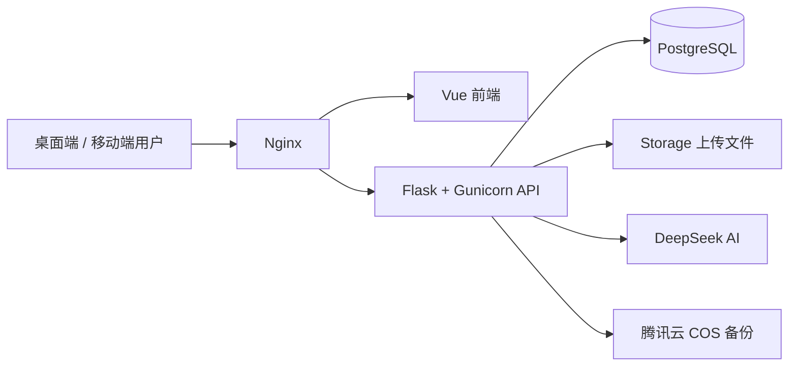

| 层级 | 主要技术 | 职责 |
| --- | --- | --- |
| 前端 | Vue 3、Vue Router、Axios、Vite | 页面交互、权限导航、移动端适配 |
| 后端 | Flask、Gunicorn | 身份校验、业务规则、文件处理、后台任务 |
| 数据库 | PostgreSQL、Flask-Migrate / Alembic | 业务数据、权限、状态和历史记录 |
| 文件 | 本地 Storage、腾讯云 COS | 问题照片、整改照片、原件、材料和备份 |
| AI | DeepSeek 兼容 API | 规范匹配、反馈标题、报告分析和文稿生成 |

## 系统功能全景

```mermaid
flowchart TB
    ROOT[业务督导中心数智管理平台]

    ROOT --> MAP[地图中心]
    ROOT --> INS[巡检系统]
    ROOT --> ASS[考核系统]
    ROOT --> PUB[公共功能]
    ROOT --> MGT[管理系统]

    INS --> REG[巡检登记]
    INS --> ISTD[巡检规范库（内部）]
    INS --> ESTD[检查表原件库（外部）]
    INS --> ISSUE[巡检问题列表]
    INS --> RECORD[巡检记录]
    INS --> MINE[我的待整改 / 待复核]
    ROOT --> SCHEDULE[排班系统]
    SCHEDULE --> SCHEDULEMAP[排班地图]
    SCHEDULE --> ROAD[路网数据]
    SCHEDULE --> PLAN[现场季度 / 视频月度排班表]
    INS --> REPORT[AI 报告生成]
    INS --> CERT[证照管理]

    ASS --> ATT[人员出勤]
    ASS --> SCORE[站点评分]

    PUB --> FEEDBACK[系统反馈]

    MGT --> USER[用户与权限]
    MGT --> STATION[站点数据]
    MGT --> CHECKLIST[检查表数据]
    MGT --> INTERNAL[内部规范数据]
    MGT --> COMPLETE[巡检封存管理]
    MGT --> AUTOAUDIT[白名单自动审核]
    MGT --> SECURITY[系统安全]
    MGT --> BACKUP[数据备份]
```

## 巡检系统

### 核心业务对象

| 对象 | 含义 | 关键关系 |
| --- | --- | --- |
| 站点 | 巡检和整改的业务主体 | 关联片区、站点账号、证照、计划和巡检记录 |
| 检查表 | 来自外部原件的结构化检查内容 | 每张表包含动态字段和多条外部规范 |
| 外部规范 | 由检查表原件拆解得到的规范 | 每条拥有全局唯一的外部规范 ID |
| 内部规范 | 业务督导中心归纳形成的巡检规范 | 一条内部规范可挂载多条外部规范 |
| 巡检记录 | 某站点在某个周期内对某张检查表的一次巡检载体 | 一条记录可包含多个问题和多名检查人 |
| 巡检问题 | 检查人引用规范后登记的实际问题 | 必须归属站点、检查表、外部规范、巡检记录和提交人 |
| 排班单元格 | 某张检查表在季度或月度周期内对某站点的计划 | 现场按外勤组、视频按单人整站安排；已有对应巡检记录即标黄锁定，不依赖审核或流程确认 |

### 规范体系与引用逻辑

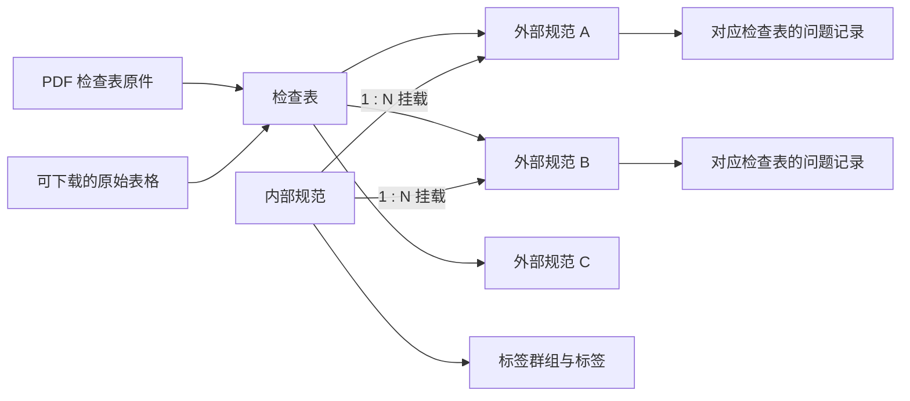

规范引用遵循以下原则：

1. 外部规范始终归属一张具体检查表，是问题进入巡检记录和报告统计的最终落点。
2. 一条内部规范可同时挂载多条外部规范，但一条外部规范不能同时归属多条内部规范。
3. 使用内部规范登记时，系统按挂载关系展开为对应的外部规范问题。一条内部规范挂载多条外部规范时，可在不同检查表记录下生成对应问题。
4. 问题列表同时展示内部与外部规范信息；巡检记录仍以外部规范和检查表为统计依据。
5. 系统可在管理端切换巡检登记使用内部规范还是外部规范。

### 巡检登记

巡检登记分为“发现问题”和“未发现问题”两种入口：

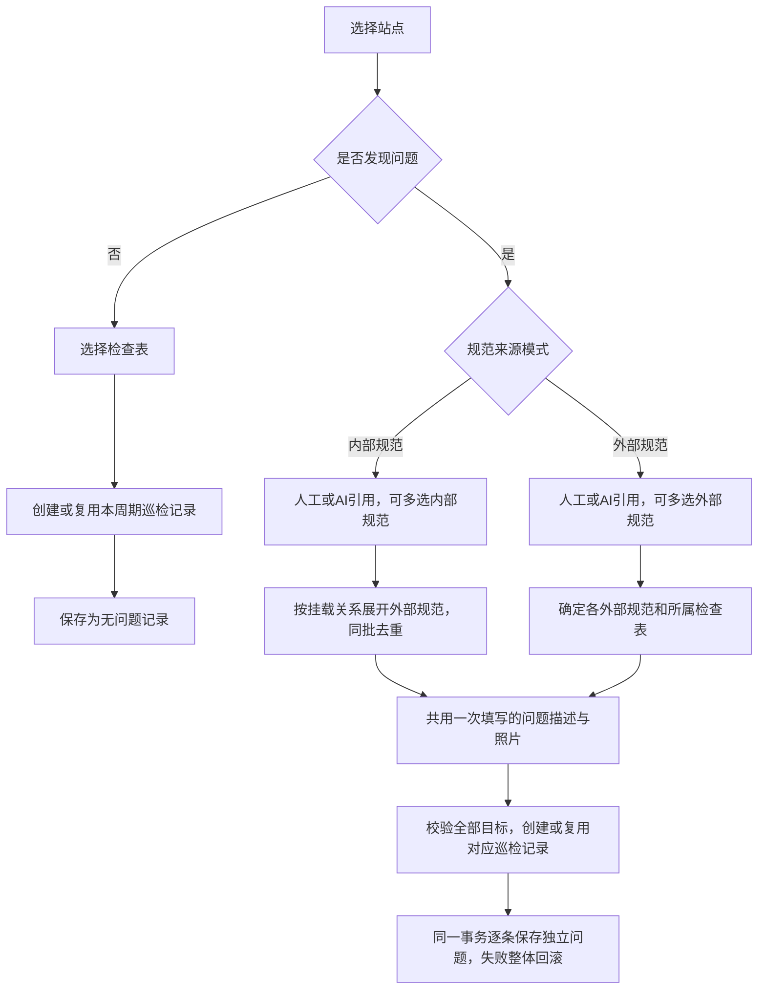

登记阶段的主要规则：

1. 默认按“自然月”控制同站点、同检查表的巡检记录唯一周期；管理员可改为自然周、自然季度或自然年。
2. 在当前周期的记录尚未确认完成时，后续提交会继续进入同一条巡检记录，不会重复新建。
3. 记录确认完成后，当前周期不再允许新增问题；进入新周期后可创建新记录。
4. 同一条巡检记录可包含多名检查人。每条问题的检查人是实际提交该问题的账号，不会统一挂到第一名检查人。
5. 问题照片支持选择、拖拽和粘贴，最多选取 3 张后进行裁剪、位置调整、圆形或矩形标注和自动拼接；标注线宽可调，最终以一张合成图保存。提交复核也复用该图片编辑器。
6. 页面提供本地草稿自动保存和恢复，会话即将过期时会提前提示用户。
7. 已选清单可跨检查表多选规范，一次提交分别生成独立问题ID，审核、整改、复核及申诉仍按每条问题单独流转。生成条数取展开、去重后的外部规范数量。

## 巡检主流程

### 端到端流程图

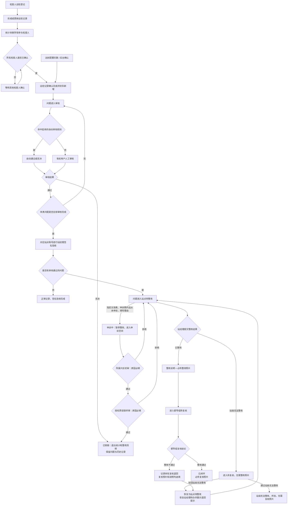

### 巡检记录状态

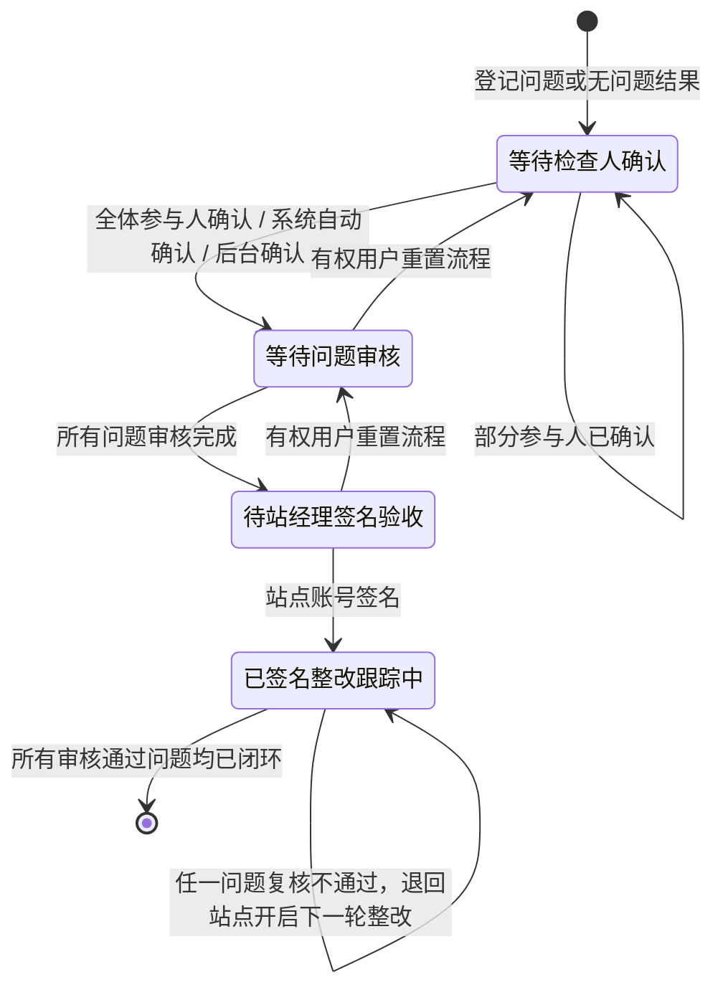

记录确认与封存规则：

| 规则 | 系统行为 |
| --- | --- |
| 多人参与 | 任意一人确认只记录本人进度，必须所有参与检查人均确认后才算完成 |
| 自动确认 | 默认超过 7 天自动确认；管理员可设置 1-31 天或关闭自动确认 |
| 完成效果 | 封存当前周期的新增入口，然后才允许问题审核；不作为排班表已检查判定的前置条件 |
| 已有问题编辑 | 检查人确认完成本身不会取消已有问题的编辑权；问题审核后则需先重置为待审核才能继续编辑 |
| 流程重置 | 只有具备“重置巡检记录流程”权限的用户可操作，并会清除关联问题的审核结果 |
| 签名后限制 | 站经理签名验收后不允许再重置巡检记录流程 |
| 删除记录 | 删除巡检记录会级联删除该记录下的巡检问题，排班表下次核对时根据剩余记录展示实绩 |

### 问题审核状态

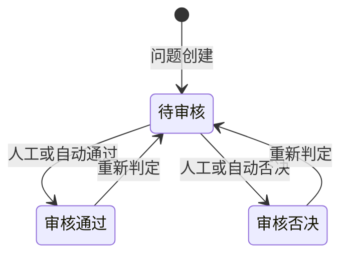

1. 问题所属巡检记录尚未确认完成时，不允许审核。
2. 自动审核只使用唯一外部规范 ID 进行全匹配，所有规则平级，可分别配置自动通过或自动否决。
3. 审核否决的问题不参与巡检记录异常数量、整改复核流转和后续报告数据。
4. 审核否决时系统会取消该问题的“优秀问题”标记。
5. 问题一旦审核，提交人的通用编辑与删除权限暂停；审核人重置为待审核后才可再次编辑。

### 单条问题整改复核状态

问题在“审核状态”之外，还有一套用于站点整改和督导复核的业务状态。页面会结合审核和巡检记录签名状态，展示用户容易理解的文案。

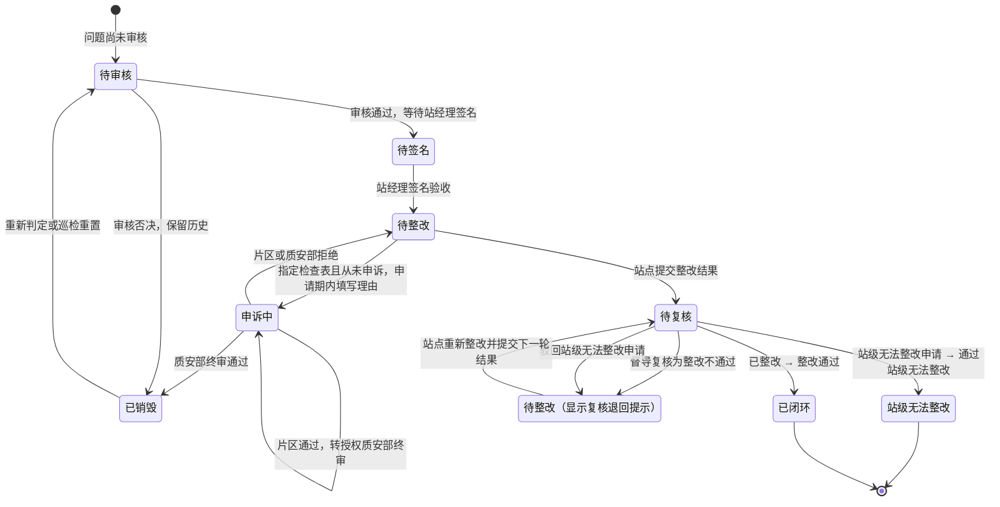

| 操作阶段 | 可选结果 | 说明要求 | 照片要求 | 下一状态 |
| --- | --- | --- | --- | --- |
| 站点整改 | 已整改 | 必填 | 必传整改照片 | 待复核 |
| 站点整改 | 站级无法整改 | 必填 | 无需照片 | 待复核 |
| 督导复核（站点已整改） | 整改通过 | 选填 | 必传复核照片 | 已闭环 |
| 督导复核（站级无法整改申请） | 通过站级无法整改 | 选填 | 无需照片 | 站级无法整改（终态） |
| 督导复核（站级无法整改申请） | 驳回站级无法整改 | 选填 | 无需照片 | 待整改，恢复站经理待办 |
| 督导复核 | 整改不通过 | 选填，建议说明退回原因 | 选填复核照片 | 待整改，恢复站经理待办 |

> v6.2 恢复站级无法整改申请和终态。此前 v6.1 已迁回待整改的问题不自动重新结案，需要站点重新提交申请并由督导复核。已销毁不是物理删除，可通过重新判定恢复。

问题流转记录遵循以下原则：

1. 登记、巡检完成确认、人工/自动审核及重新判定、签名及撤销、问题修改和状态调整均纳入流转记录。历史审核只补回数据库中仍存在的最后一次结论，不虚构早期事件。每次“提交整改”和“提交复核”都写入独立历史记录，保留轮次、操作人、时间、前后状态、结果、说明和照片。
2. “整改不通过”不是终态：问题从“待复核”恢复为“待整改”，重新出现在对应站点账号的待办中，并显示上一轮退回原因和退回时间。
3. 站点重新提交整改时进入下一轮“待复核”；当前复核展示字段会为新一轮清空，但上一轮结果、说明和照片（如有）继续保存在历史记录中。
4. 巡检记录只有在全部审核通过问题都“已闭环”或“站级无法整改”后，才完成整改跟踪；存在被退回或待复核问题时仍处于跟踪中。
5. “我的待整改 / 待复核”和“巡检问题列表”均可查看完整流转时间线，站点账号只能处理本站被退回的问题。

### 巡检排班表

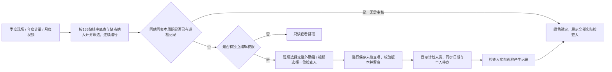

计划逻辑：

1. 季度现场、年度计量和月度视频各有统计周期；年度计量按月度片区配额与季度现场联动，详见v10.5说明，不使用Excel模板派工。
2. 共用指定的155站排序底表，站点对应纳入开关关闭时不展示，筛选纳入站点后连续编号；无额外视频排除名单。排班全局共享，不按账号片区或检查表范围过滤。
3. 现场按完整外勤组、视频按单人整站安排未检查项；拖拽、复制、取消均以整行处理，实绩与安排分开保存。
4. 已有记录即只读标绿，包括未审核、零问题或未确认的记录；删去最后一条对应记录后恢复原保存排班或待排班，已排班标红。
5. 查看与编辑分别授权，编辑依赖查看，普通账号默认不开启；巡检问题和巡检记录等其他页面仍保留其原有数据范围。
6. 保存使用事务锁、版本校验与审计记录，并同步检查人个人待办；现场、年度计量及视频均按对应排班周期内同站同表记录销项，未完成项跨日保留在相应历史分类。

### 主要页面与职责

| 页面 | 主要职责 |
| --- | --- |
| 巡检登记 | 选择站点、引用内部或外部规范、登记问题或无问题结果 |
| 巡检规范库（内部） | 查看内部规范、标签和所挂载的外部规范，支持筛选和 PDF 导出 |
| 检查表原件库（外部） | 预览 PDF 原件，下载原始表格，查看和导出检查表拆解得到的外部规范 |
| 巡检问题列表 | 按数据范围查询问题，审核、编辑、删除、更换检查人、设置优秀问题、查看整改退回状态与完整流转记录、后台导出 |
| 巡检记录 | 按站点与检查表查看检查结果、参与人进度、问题审核进度、站经理签名和整改进度 |
| 我的待整改 / 待复核 | 站点提交已整改或站级无法整改申请；督导按对应分支通过或驳回，驳回后退回站点；流转记录单独查看 |
| 巡检排班 | 现场季度、视频月度排班；工作日档期校验，单格/批量/复制/今日均衡派工，同步个人待办，实绩自动销项 |
| AI 报告生成 | 按报告类型和时间范围汇总已完成记录与审核通过问题，异步生成报告并导出 PPT |
| 证照管理 | 维护站点证照有效期，按证照规则生成正常、推荐提醒、法定提醒和已过期状态 |

### 管理端对巡检系统的支撑

| 管理功能 | 作用 |
| --- | --- |
| 检查表数据管理 | 新建、编辑、删除检查表，维护动态字段和外部规范 |
| 巡检规范库数据管理 | 维护内部规范、标签群组、标签和外部规范挂载关系 |
| 巡检封存管理 | 配置记录唯一周期、自动确认天数，查看并管理巡检记录完成状态 |
| 白名单自动审核管理 | 按唯一外部规范 ID 设置平级的自动通过 / 否决规则，并提供回溯导出 |
| 用户数据管理 | 分配页面、操作、数据范围、检查表范围和片区范围权限 |
| 页面显示管理 | 全局显示或隐藏页面；某子系统下页面全部隐藏时，同步隐藏子系统菜单 |

## 权限与数据范围

前端菜单隐藏只用于改善交互，最终安全判断由后端根据签名会话中的当前用户执行。

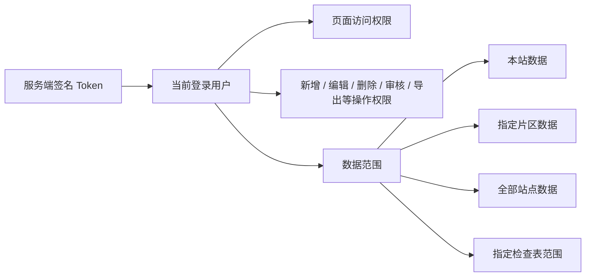

权限原则：

1. `root` 拥有全部权限，其他角色使用“角色通用权限 + 用户个性化权限”的模式。
2. 用户存在个性化权限时，个性化权限优先于角色通用权限。
3. 本站、片区和全部站点是互斥的主数据范围，可叠加检查表范围限制。
4. 站点账号和片区账号默认不查看待审核问题，只在问题完成审核后进入其可见范围。
5. 检查人姓名和手机号可通过独立权限对特定角色隐藏。
6. 已闭环问题原则上不可修改或删除，只有 `root` 可在必要时使用管理权限处理。

## 数据一致性与追溯

1. 外部规范 ID 是规范的全局唯一标识，已被业务数据引用的规范不允许删除，但可修改内容并在关联页面中同步展示最新内容。
2. 巡检问题保留问题照片，以及每轮实际提交的整改/复核照片和对应时间；“整改不通过”可选填复核照片，提交后同样保留本轮照片供历史追溯。
3. 整改和复核采用追加历史记录，逐轮保留操作人、状态变化、结果、说明和照片，不会因复核退回或再次提交而丢失上一轮信息。
4. 删除问题会同步更新巡检记录结果和相关计划完成情况；删除巡检记录会级联删除其下问题。
5. AI 报告主要使用已确认完成的巡检记录和审核通过的问题，AI 生成内容在页面和导出结果中应带有明确标识。

## 本地运行与验证

本地开发环境的 `/api/version` 直接读取前端 `package.json`（Docker 只读挂载），随前端版本更新，无需手动配置 `APP_FRONTEND_VERSION`，避免旧版本配置造成反复提示刷新。仅 `APP_ENV=development` 使用此行为；生产环境继续使用 `deploy.sh` 从前端构建版本设置的 `APP_FRONTEND_VERSION`，不读取开发版本文件。

后端首批渐进式重构仅拆分手动备份传输的 HTTP 适配与任务编排，保持原接口、权限、锁与事务顺序，不修改自动调度或业务版本。依赖审阅、隔离验证方式及已知多 worker 并发风险见 [首批重构说明](docs/backend-refactor-batch-1.md)。

第二批提取备份配置规范化与时间计算，JSON 读写、接口和调度仍保留在 `app.py`，不改变频率算法、保存/清理顺序或锁。边界、兼容契约及验证结果见 [第二批重构说明](docs/backend-refactor-batch-2.md)。

第三批提取 COS 备份适配，保留原 SDK 可选加载、分页、分片上传、上传校验及云端保留策略，不改变接口、权限或调度。边界、隔离验证与未修复风险见 [第三批重构说明](docs/backend-refactor-batch-3.md)。

第四批提取备份 ZIP 清单和 storage 成员路径校验，保留原恢复顺序、异常映射及路径规则，不执行或改动真实恢复。兼容测试与存量校验风险见 [第四批重构说明](docs/backend-refactor-batch-4.md)。

第五批提取本地备份列表、storage 打包排除规则、归档暂存发布和旧包清理，保留原文件操作顺序、错误及并发边界。实现与验证已完成，详见 [第五批重构说明](docs/backend-refactor-batch-5.md)。

```bash
# 构建并启动本地开发环境，后端启动时会自动应用 Alembic 迁移
docker compose up --build

# 前端构建验证
cd frontend
npm run build

# 后端测试
docker compose run --rm --no-deps backend \
  python -m unittest discover -s tests -p 'test_*.py'

# 检查数据库迁移状态
docker compose exec backend python -m flask db current
docker compose exec backend python -m flask db heads
```

## 文档维护约定

涉及以下变更时，应同步更新本 README：

1. 巡检记录确认、问题审核、签名、整改或复核状态变更。
2. 内部与外部规范映射关系变更。
3. 巡检计划周期、派工或完成判定变更。
4. 巡检页面权限、数据范围或角色默认权限变更。
5. 巡检记录或问题的删除、重置和级联处理规则变更。

### v6.1 流转升级说明

部署时执行 Alembic 升级至 `20260905_001`，增加事务内生命周期触发器并补录可恢复的历史审核、完成确认和签名。迁移可重复执行；回退仅移除触发器，不删除审计证据或逆转用户后续的整改状态。流转查询为只读，提交整改/复核单独操作；已提交整改照片不再提供单独替换接口。

### v6.2 流转升级说明

部署时执行 Alembic 升级至 `20260905_002`。迁移将审核否决的问题标记为已销毁，统一历史复核通过名称，并完善巡检重置事件；可重复执行，不删除问题或历史记录。降级不反向修改业务状态或删除流转证据，旧版应用不支持新增复核分支，不建议仅回退代码。站级无法整改申请通过后保留为独立终态，驳回后返回待整改。站点提交整改弹窗不再加载或展示流转记录，请通过“查看流转”单独查询。

### v6.4 申诉空间

部署前执行 Alembic 升级至 `20260905_003`。新增申诉表、同一问题仅一条进行中申诉的唯一索引，以及流程重置时取消申诉的触发器；迁移可重复执行，不改动已有问题。回退不会删除申诉证据，回退旧代码前须先处理完进行中的申诉，避免旧版本无法展示或处理“申诉中”状态。

- 申诉入口位于站点“我的待整改问题”的提交整改下方。仅支持计量稽查检查表（视频/现场）、环境无异味管理检查表（现场）、质量安全环保检查表（视频/现场），且问题须审核通过、已签名验收并处于待整改。
- 申诉理由必填；提交后暂停整改并跳转“申诉空间”。任何用户都可访问菜单，但站点只看本站，片区仅看配置管理片区，质安部查看申诉，其他角色沿用原问题数据范围。
- 片区默认可初审所管站点，管理范围沿用用户数据管理的“巡检问题列表 → 站点所属地范围”，未配置范围不授予全区审核权。片区通过后转质安部；终审必须是质安部角色且由 root 分配“申诉空间 → 质安部申诉终审”权限。root 可查看与授权，不替代两个业务角色越级审核。
- 两级审核均需原因。任何一级拒绝后回到待整改并显示原因、时间和退回提示；v6.5 起每个问题终身只可申诉一次（拒绝或取消后也不可再次发起）。质安部通过后标记已销毁，同时退出审核通过的数据统计口径，不物理删除。已结束申诉不在待处理列表，保留只读历史查询。
- 发起、初审通过/拒绝、终审通过/拒绝和巡检重置导致的取消全部写入问题流转记录。重复提交、阶段过期及跨站点/片区请求由后端拒绝，不依赖前端隐藏。

### v6.5 申诉提醒与流转优化

部署前将 Alembic 升级至 `20260906_001`，再启用新代码。迁移可重复执行：新增问题申诉占用表和账号已读表，回填所有历史申诉的问题ID；数据库触发器限制新申诉，一次资格不会因单条申诉记录删除而释放。旧版本产生的重复申诉保留，不删除或篡改历史数据。

- 菜单角标为当前账号数据范围内的“进行中申诉 + 已结束未读结果”。进行中查看后仍计数；结束后转为未读，在已结束记录中点击“查看处理结果”才标记本账号已读，其他账号不受影响。已有结束记录初次升级按未读处理。
- 站点/片区/质安部进度卡展示处理阶段、归属、实际审核人或可审核人员；初审通过不代表终审通过。站点申诉失败后回到待整改，显示拒绝原因且不再显示申诉入口。
- 新申诉业务动作与状态变更合为一个流转事件；旧记录只在同一精确时间、同一操作者且状态一致时合并展示。问题审核与申诉审核分栏标识，旧版重复申诉另标次数，底层证据不修改。
- 降级保留申诉占用和已读数据，仅解除一次申诉触发器。恢复旧应用可能重新允许申诉，不建议回退到 v6.4；若重新升级会补齐新产生的占用记录。
- 本地回归：`ISSUE_LIFECYCLE_DB_TEST=1 python -m unittest tests.test_issue_appeals tests.test_issue_lifecycle tests.test_issue_flow_presentation`（在后端目录执行，数据库测试全程事务回滚）；前端执行 `node --test tests/*.test.mjs`。

### v7.0 亮点登记与亮点列表

巡检登记的“是否为亮点登记”默认否；选是后选择站点、检查表，填写亮点描述和照片，共用手机拍照、相册、多图拼接及图片编辑。亮点只写入独立的 `inspection_highlights` 表，使用独立序列显示为 HL1、HL2 等，不占用问题ID，不创建巡检批次、巡检记录、规范关联，也不参与自动审核白名单、统计报告或整改复核。

亮点状态为“待审核 → 已确认亮点 / 审核未通过”，复用问题审核权限及站点、片区、检查表数据范围，审核重置与重新判定记录在 `inspection_highlight_audits`。接口使用服务端登录身份，审核锁定行并校验客户端看到的旧状态；仅当前操作行等待，不阻塞其他亮点审核。亮点列表独立展示，服务端分页、主动筛选，手机使用卡片展示及照片放大。站点/片区待审核可见性和检查人员联系方式隐藏与问题列表一致。

部署需执行 Alembic `20260909_001`，只增加亮点及审核记录表和索引，不迁移或修改现有巡检问题。菜单位于巡检问题列表下方，页面显示管理可独立控制，业务权限沿用巡检问题权限配置。

### v6.9 待复核列表轻量加载

备份维护：COS 使用 16MB 分块、2 路并发和分块 MD5 校验，支持超过 5GB 的备份；云端完整对象大小及列表核对成功后只保留最近 1 份。上传失败不清理旧备份。同地域腾讯云服务器可配置 `COS_USE_INTERNAL=true` 使用 HTTPS 内网域名，默认关闭以兼容本地环境；可在服务器专有的 `docker-compose.override.yml` 中配置（不入库）。

“我的待复核问题”默认不限制月份或日期，仍查看全部历史待复核问题，但只请求当前页（桌面20条、手机5条）。筛选面板采用草稿与已应用条件分离，点击“开始筛选”后由数据库检索全队列；翻页、提交复核后的刷新仍使用已应用条件，末页为空时自动回到有效页码。移动端保留之前的站点选择记忆。

手机端直接显示站点名称、检查表和关键词搜索，不提供展开/收起。关键词搜索覆盖当前问题的规范详情、问题描述、整改/复核说明、站点、检查人、规范ID和标签等文字字段；多个词用空格或逗号分隔，同一问题需包含所有词，各词可以匹配不同字段。点击“开始筛选”或键盘搜索后在服务端检索全队列，保留分页和原有权限，不读取照片文字或调用AI；桌面筛选不受手机关键词影响。

`GET /api/my-issues` 对root、督导组返回分页对象，站点账号保留原待整改数组接口及流转逻辑。新接口 `GET /api/my-issues/filter-options` 单独返回全待复核队列的去重选项，不读取全量问题描述或照片；两个读取均不按客户端用户ID扩大范围。待复核读取移除巡检结构初始化、巡检完成同步和超时批量更新，保留既有权限初始化机制。权限仍沿用原待复核的root/督导组角色范围，不改变复核提交鉴权。

部署需正常运行Alembic迁移 `20260907_001`，增加可重复执行的待复核队列部分索引，不修改任何业务状态。测试覆盖全时间范围、跨页查询、外部规范ID精确匹配、角色鉴权及索引重复执行。

### v6.8 报告字体与翻页优化

六类PPT的正文、表格、图表、母版、主题和内嵌图表工作簿统一只声明微软雅黑（Microsoft YaHei）或宋体（SimSun）。兼容版本升级会重新准备旧成稿的文件与预览，不重新调用AI。移除导出弹窗重复创建入口，正常直接下载与预览一致的文件，仅失败时提供重试。

预览按报告实例缓存最多8页、24MB图片（单张当前页可超过上限），并预加载前1页、后2页，并发上限2。切换成稿或离开页面取消请求并释放URL，不持久保存账号私有图片；页面接口仍检查权限，后端仅验证所请求图片，不再每次遍历整份报告的图片文件。

**部署字体注意：** 微软字体文件不随仓库分发。管理员应将有合法使用授权的微软雅黑及宋体 `.ttf/.ttc` 放入 `storage/report_fonts`，Compose已挂载此目录，后端启动刷新字体缓存。缺少字体时Linux渲染器仍会使用系统替代字体，无法保证网页字形与WPS完全一致；应在部署时用 `fc-match 'Microsoft YaHei'` 和 `fc-match 'SimSun'` 核实匹配，避免误以为仅修改PPT字体声明就已安装字体。

### v6.7 报告PPT兼容性

六类报告统一通过 `backend/pptx_compatibility.py` 处理原生图表、数值缓存、坐标轴和字体。柱形/条形图下方使用独立可编辑的PPT表格，明确写入零值；不删除零值站点，不用非零小数冒充0。图表、内嵌工作簿、文字和表格仍可编辑，导出不是整页图片。

网页默认预览由最终导出的同一份PPT经容器内LibreOffice渲染，使用鉴权图片接口按页加载，不再独立拼装另一套HTML版式。首次准备需要转换时间，不调用AI；`report_ppt_artifacts.py` 按成稿内容、非油源PPT和兼容版本缓存，跨进程锁防止重复转换，转换串行执行避免并发占满资源，同一缓存文件用于预览和下载。导出任务仍按登录用户鉴权，成稿共享规则不变。派生缓存30天未使用后清理，不删除原始成稿；无需数据库迁移。

自动测试覆盖零值、小数、全零图表、可编辑工作簿、六类报告缓存及预览权限；容器内进行了实际渲染检查。不同办公软件仍可能因字体或图表引擎存在差异，旧版/企业版WPS需要在目标环境补充验收，不能保证像素级一致。

### v7.1 质安流程时限管理（取代 v6.6 共享审核时限）

仅适用计量稽查检查表（视频/现场）、环境无异味管理检查表（现场）、质量安全环保检查表（视频/现场）。root 通过“管理系统 → 质安流程时限管理”（`/management/quality-deadlines`）分别启用或关闭验收、申请、片区初审、质安部终审四项时限，调整工作小时数（1至8760的整数），两级审核分别选择超时处理方式。可按巡检记录ID、问题ID、事件类型筛选追溯日志；普通角色不能访问管理接口，身份以服务端当前登录用户为准。以下倒计时仅在对应开关启用时执行。

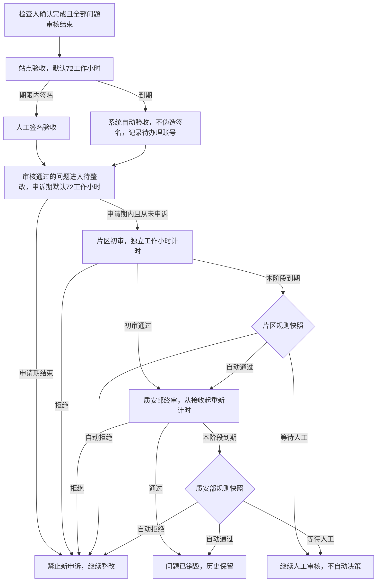

- 验收期限从“检查人确认完成且全部问题审核结束”的时刻起算，不从巡检登记日期倒推；有待审核问题不能自动验收。自动验收保留兼容的已验收状态，以独立来源字段区分，巡检记录支持筛选，所含问题均追加系统自动验收流转记录。
- 申诉申请期从验收后问题进入待整改开始（首次上线存量待办有宽限）。到期按钮置灰，后端同时拦截，包括在到期前打开弹窗、到期后提交。已经发起的申诉不受申请期结束影响；问题仍仅可申诉一次。
- 片区与质安部各自默认72工作小时，片区通过后质安部重新计时。超时默认等待人工；片区自动通过只转交终审，质安部自动通过才销毁问题，任一级自动拒绝均恢复整改。不冒用人员身份，两级先后超时分别保留处理时间、人员快照和生命周期记录。
- 四个开关分别确认、立即持久化。关闭某项解除该项已有待办限制，人工流程正常；重新启用给予该阶段未结束任务完整期限，已结束事件不重开。只调整小时数或处理方式不改变已开始任务的快照。
- 北京时间工作日全天24小时累计，普通周末和法定节假日暂停，国务院调休补班日计时；不是朝九晚五工时。`chinesecalendar==1.11.0` 提供2004–2026年官方安排，迁移写入 `quality_work_calendar`，计时在PostgreSQL函数中执行，无外部实时API依赖。前端共享缓存日历、每分钟更新显示，非工作日剩余小时不递减。
- 日历缺失年份不推测：无法计算的截止时间返回空，暂停自动判定及申请到期拦截，保留人工流程。管理页显示覆盖范围。下一年国务院安排公布后，更新并固定依赖版本，在后端执行 `python sync_quality_calendar.py` 补充日期；该命令可重复执行，不覆盖已有日历及历史证据。补齐后低频扫描继续计算待办。旧年份更正需要单独核查任务快照，不能直接覆盖生产日历。
- `quality_deadline_events` 保存配置人、规则版本、截止时间、自动处理时间、超时阶段、阶段接收人员和超时时有权限的账号。无可用账号也明确记录，供人工核查权限缺失与管理安排，日志不是自动认定某个人失职的结论。即使之后问题被删除，管理追溯信息仍保留。
- 部署先安装新依赖并迁移至 Alembic `20260909_002`。旧天数乘24转换为小时；旧审核开关及超时方式分别复制到两级。迁移为未结束任务提供升级时刻起的新完整期限，重复执行不重置自定义设置或宽限起点；历史时限、策略字段和日志不删除。Docker入口先迁移和验证结构，再用 Gunicorn `post_worker_init` 启动后台扫描。默认每180分钟唤醒，`QUALITY_DEADLINE_SCAN_MINUTES` 可调30至1440分钟；各实例保持一致。数据库事务锁与 `next_scan_at` 防止重复扫描，重启不清除调度时间，关闭功能跳过扫描，单批最多200条，失败回滚并低频重试。
- 以性能优先，超时处理允许延后数小时；重启、积压或失败可能更久。前端离开不影响后台，实时申诉资格由后端校验。阶段到期但未自动处理时提示等待后台。
- 本版本只提交推送，不部署生产。部署前root核实四项小时数、两级超时策略、日历覆盖、片区范围及终审权限。回退前停止自动任务；降级保留规则、日历、证据，不撤销已发生结论。旧代码使用共享天数语义，不能只回退应用并继续运行后台任务，需另行制定兼容迁移。
- 本地测试：`ISSUE_LIFECYCLE_DB_TEST=1 python -m unittest tests.test_quality_deadlines tests.test_issue_appeals`，数据库测试均在事务内回滚；前端 `node --test tests/*.test.mjs`。
